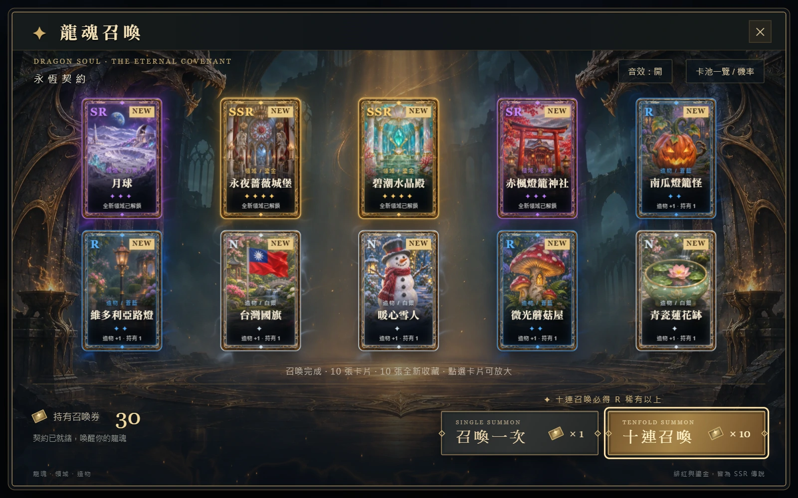

# 龍魂召喚

抽卡首頁、單抽、十連、卡池一覽與收藏頁共用全幅卡片元件。共有 52 張對應卡圖：23 種龍、10 個場景（含初始森林）、19 件裝飾；抽卡池中實際為 51 種。新增月球、三座聖域，以及 12 件花園珍藏裝潢，完整清單見 [SPEC-UGC §9.7](SPEC-UGC.md#97-花園珍藏2026-11-18)。

## 卡色與機率

| 卡面 | 遊戲稀有度 | 用途 |
| --- | --- | --- |
| 白銀 | N | 普通 |
| 蒼藍 | R | 稀有 |
| 幻紫 | SR | 史詩 |
| 鎏金 | SSR | 傳說 |
| 緋紅 | SSR | 帝王暴龍、翔空蒼龍的特別卡面 |

基礎機率仍為 62% / 27% / 9% / 2%，十連保底 R 以上。緋紅不是第五個遊戲稀有度。新增品項在其稀有度內均分機率；扣券、保底、重複轉換與存檔格式沿用既有規則。

## 演出與互動

- 召喚券不足時顯示取得方式，按鈕停用；請求與演出期間鎖住重複抽取。
- 卡背入場 → 能量蓄積 → 牌發好後停住，顯示「點擊翻牌 / 點擊開始翻牌」，玩家按一下（點牌區任一處或 Enter；發牌途中先按也算）才開始：單抽翻這張，十連依格子順序自動逐張 3D 翻卡（左上 → 右上，再左下 → 右下）。白 / 藍卡連續快翻；紫卡（SR）以上「瞇牌」：其他卡壓暗、該卡浮起，翻一點就停住（SR 兩段、SSR 三段，越翻越抖、底光心跳），往回收一點蓄力後啪地翻到正面（白閃、震動、能量衝擊）。節奏參數在 `GachaPanel.ts` 的 `SQUEEZE` / `FLIP_STEP`，樣式在 `summon-squeeze.css`。十連的 SSR 翻開後另有中央卡片特寫、傳說字幕。
- 一張共享 WebGL 畫布負責 domain-warped FBM 煙霧、流動卡緣光焰、餘燼、能量衝擊與光暈；卡面以 CSS 3D 與箔光處理滑鼠視差。
- 卡緣光焰使用卡面四角的實際瀏覽器投影，每次繪製更新四邊形距離場；旋轉、透視、浮起及翻卡均會同步，CSS 底光也位於同一翻轉層。翻卡前後的頂點繞序與側面退化情況另有處理。
- 可切換音效、跳過演出、放大鑑賞、依龍魂／領域／造物篩選卡池；收藏頁沿用等級與升級操作。
- 關閉取消動畫計時器（不取消抽卡本身）。結果完整看過後關閉，下次開啟回到首頁；還沒看完的結果（翻到一半就關、或關閉期間才回來的晚到結果）下次開啟先顯示一次，看過再關才回首頁。請求尚未回來時，重新開啟仍會鎖定。
- Escape 先關閉卡片鑑賞／卡池，第二次才關抽卡面板。面板內有鍵盤焦點循環與狀態朗讀。
- 特效以 30 fps 更新，畫布上限 1300 × 900；關面板／分頁隱藏時停止繪製。WebGL 無法初始化時保留卡面與 CSS 演出；減少動態效果偏好直接顯示結果。
- 使用遊戲設計座標的 container queries：桌面十連為 5 × 2，直向窄畫面改為可捲動的 2 或 3 欄。

## 素材與維護

- `public/res/gacha/illustrations/`：原有 8 張 WebP 插畫檔，以及 16 張獨立 1024×1536 的新場景／裝潢插畫。新卡沒有共用占位圖。
- `public/res/gacha/sanctuary.webp`、`card-back.webp`：召喚聖殿與雕刻金屬龍紋卡背。
- 以上美術使用內建 `image_gen` 生成；完整最終提示詞在 [GACHA-ART-PROMPTS.json](GACHA-ART-PROMPTS.json)。以專案 C3B 模型輸出作為龍族身份參考，卡面是美術重新詮釋。
- 2026-11-18 新增的 16 張使用內建 `image_gen`，每個資產各自生成。提示詞、資產檔名與目的資料夾完整記錄在 [HOMESTEAD-ART-PROMPTS.json](HOMESTEAD-ART-PROMPTS.json)，PNG 原稿保留在生成工具目錄，專案使用 WebP。
- 裝潢選單與家園場景選擇共用這些插畫；造物鑑賞顯示說明、實際占格數與旋轉提示，收藏卡顯示占地與持有數。
- 收到抽卡回覆後先解碼該批卡圖，再開始發牌，避免獨立大圖第一次揭曉時空白；最長等待 8 秒，讀取失敗仍保留既有名稱備援。這段等待不改動 server 入帳或扣券。


- `public/res/gacha/portraits/`：36 張原模型輸出的參考圖。`tools/gacha-art.html` / `gacha-art.ts` 為只在開發階段使用的輸出工作室，不進入主遊戲 bundle。
- `GachaArtwork.ts` 定義圖集格位；新增物品時需一併補插畫映射。測試會檢查全卡池覆蓋、格位唯一與圖集比例。
- `tools/import-gacha-art.mjs <manifest.json>` 只轉為 WebP，不重新生成、不修改原始圖；manifest 是 `[{ "source": "原圖絕對路徑", "destination": "輸出路徑" }]`。

## 驗證

```powershell
npm run build
npm test
# 瀏覽器工具為選用的開發依賴，未變更專案套件清單。
npm install --no-save --package-lock=false playwright
npm run dev
# 另一個終端機；使用獨立無頭 Edge，不使用玩家的瀏覽器存檔。
node tools/check-gacha-ui.mjs
node tools/check-gacha-projection.mjs
```

瀏覽器檢查包含實際十連扣券、連點阻擋、跳過、全部卡色、SSR 特寫、單抽、收藏、卡池篩選、關閉中的延遲回覆、失敗恢復、直向畫面和減少動態效果；畫面輸出在 `node_modules/.cache/gacha/`。測試用的固定全卡色結果只存在於自動化腳本，不會加入正式遊戲。

投影回歸工具以 Chromium DevTools 的實際 DOM 四角座標，獨立比對 GPU 收到的四角 uniform，涵蓋扇形、滑鼠傾斜、翻卡兩面、衝擊中心、縮放和隱藏卡片；容許誤差為 0.25 個螢幕像素。
