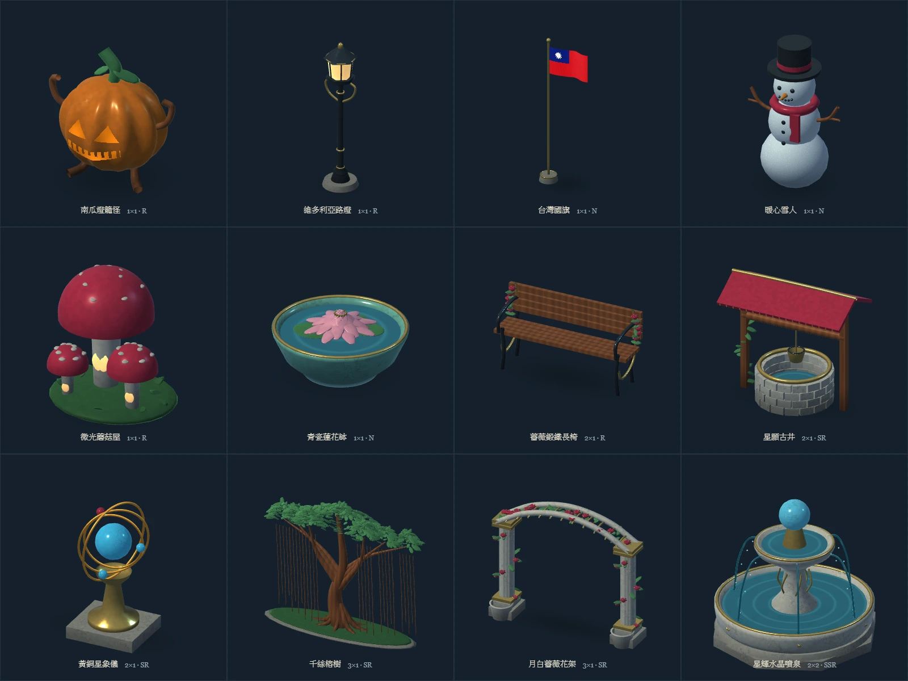
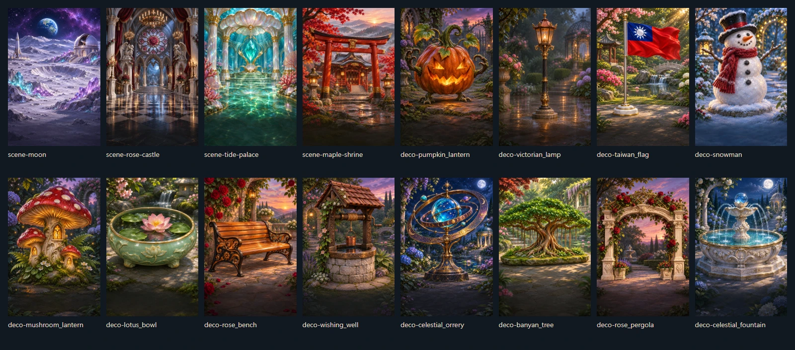
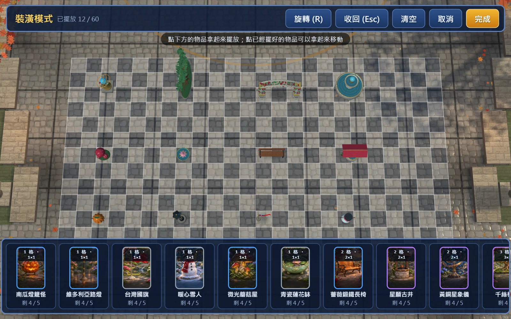

# UGC 家園版 規格書

> 分支：`ugc-homeland`　狀態欄：✅ 已完成　🚧 進行中　⬜ 未做　｜　機制、12 件花園模型與插畫卡面已實作，新增內容見 §9.7
>
> 本文件是「恐龍大亨 3D 網頁版」改成 UGC（玩家自創內容）版本的規格。
> 戰鬥本體（魚、砲台、子彈、表演）沿用 `docs/SPEC.md`，這裡只寫 UGC 新增 / 改動的部分。

---

## 0. 目標

把原本「單一房間、什麼都有」的捕魚遊戲，改成每個玩家都有自己家園的版本：

1. **1 號房 = 公有地**：就是改版前的樣子，所有龍、所有場景都有。
2. **2 ~ N 號房 = 玩家家園**：每個玩家一間，內容由屋主自己決定。
3. 新玩家只有**初始 11 種龍**（幼幼龍 ~ 翼龍）和**草地場景**（森林）。
4. 其他龍 / 場景 / 裝飾物，要到**公有地或別人的家園**打魚，掉落**抽卡券**，再去**抽卡**取得。
5. 抽到的龍可以**培養**：等級越高倍率越高，也越難被打死。
6. 別人到我的家園打魚，我可以拿到**抽成**。
7. 屋主可以設定家園：**場景輪替**（可重複）、**放出哪些龍**、**裝潢**（俯視 + 棋盤格擺放）。
8. 放龍限制：每個場景最多 **3 隻 Boss**；風神翼龍、翔空蒼龍只能放在**天空場景**。

### 0.1 這一版的前提（重要）

| 項目 | 這一版的做法 |
|---|---|
| Server | 沿用假 server（瀏覽器內），所有 UGC 規則寫在假 server 模組裡；協定照真 server 的方式設計，之後換 `WebSocketTransport` 即可 |
| 其他玩家 | 只有本機一個真人玩家。其他玩家的家園 = **8 個 NPC 屋主**（固定內容）；到我家園的訪客 = **模擬訪客**（依人氣算收益） |
| 存檔 | 玩家資產存在瀏覽器 `localStorage`（`d3.ugc.profile.v1`），換瀏覽器 / 清資料就重來 |
| 裝飾物 | 12 件正式花園模型與卡圖，保留 7 件舊物品以相容存檔（§9.6、§9.7） |
| 數值 | 所有數值集中在 `src/game/ugc/` 的定義檔，都是可以調的常數，這一版先求機制完整 |

---

## 1. 名詞

| 名詞 | 說明 |
|---|---|
| 公有地 | 1 號房，系統的房間，所有魚種、所有場景 |
| 家園 | 玩家自己的房間（我的家園 = 2 號房，NPC 家園 = 3 ~ 10 號房） |
| 屋主 | 家園的擁有者 |
| 魚卡 | 擁有某種龍的憑證，有等級（1 ~ 10）與碎片數 |
| 碎片 | 抽到已擁有的龍 → 變成該龍的碎片，升級要用 |
| 抽卡券 | 抽卡用的貨幣，打魚掉落 |
| 場景格 | 家園輪替表裡的一格 = 一個場景 + 這個場景要放出的龍 |
| 人氣 | 家園的吸引力分數，決定模擬訪客人數 |
| 抽成 | 訪客開砲成本的一部分，歸屋主 |

---

## 2. 房間

### 2.1 房間清單

| 房號 | 類型 | 屋主 | 內容 |
|---|---|---|---|
| 1 | 公有地 | 系統 | 10 個場景輪流（原 6 景 + 月球、城堡、水晶殿、神社），所有支援的魚種 |
| 2 | 家園 | 我 | 依我的家園設定 |
| 3 ~ 10 | 家園 | NPC | 固定內容（`server-fake/ugc/npcHomes.ts`），進度由淺到深 |

- 啟動後先進 1 號房。
- 上方功能列的房間按鈕 → 房間列表：顯示房號、屋主、場景、魚種、最高等級、人氣；選一間可以看詳細內容（輪替表、每種龍的等級與倍率），按「進入」換房。
- 換房：場上的魚、飛行中的子彈清掉（子彈成本退回），場景依新房間切換，重新同步魚群。

### 2.2 場景輪替

- 每間房都有一張**輪替表**（場景格的陣列），每格固定 **150 秒**，到時間換下一格，最後一格回到第一格。
- 公有地的輪替表依 `SCENE_LIST` 建立（目前 10 景），每格放所有魚種。
- 進房時從哪一格開始：依伺服器時鐘算（`floor(時間 / 150 秒) % 格數`），所以短時間內重進同一間房會看到同一個場景。
- 相鄰兩格是同一個場景（屋主刻意重複）→ 不轉場、不清場，只換放出的魚。
- 輪替表只有一格 → 不輪替。
- Debug 面板的場景下拉選單照舊可用（臨時換場景，到下一次輪替為止）。

### 2.3 魚群排程（家園怎麼只放出指定的龍）

沿用原版群組資料（`GroupData.json`）與排程種類（small / medium / big / special / knight / boss）。

- 每個場景格有一份「允許魚種」清單。
- 一個群組只要含有**至少一隻允許的魚**就可以出；群組裡**不允許的魚在出場時就標成已死亡**（`deadFishes`），client 不會生出來、server 也不接受對牠的命中。
  - 例：屋主只放棘龍 → 群組 21（刺甲龍 + 太古劍龍 + 棘龍）出場時只會看到棘龍。
- 場景限制（§5.3）以「允許的魚」判斷。
- 家園的 Boss 是屋主特地放的，出場頻率比公有地高：

| 排程 | 公有地 | 家園 |
|---|---|---|
| boss | 每 180 秒、首次 20 秒 | 每 50 秒、首次 10 秒 |
| knight | 每 90 秒、首次 12 秒 | 每 45 秒、首次 12 秒 |
| 其他 | 不變 | 不變 |

---

## 3. 玩家資產（Profile）

```ts
interface PlayerProfile {
  version: 1;
  accountId: number;          // 本機玩家 = 1
  name: string;
  money: number;              // 金幣
  tickets: number;            // 抽卡券
  fish: Record<fishType, { level: number; copies: number }>;  // 擁有的魚卡
  scenes: number[];           // 擁有的場景
  decos: Record<decoId, number>;  // 擁有的裝飾物數量（含已擺放的）
  home: {
    slots: HomeSlot[];        // 場景輪替表
    deco: DecoPlacement[];    // 裝潢配置
    pending: number;          // 尚未領取的抽成
    totalEarned: number;      // 累計抽成
    lastAccrueAt: number;     // 上次結算時間（毫秒，離線收益用）
  };
  stats: { draws: number; ticketsEarned: number };
}
```

### 3.1 初始資產

| 項目 | 內容 |
|---|---|
| 金幣 | 31,708,504（沿用原本的值） |
| 抽卡券 | 10（讓新玩家可以先抽一次十連） |
| 魚卡 | 1 ~ 11 號各 Lv.1：幼幼龍、蛋蛋龍、蛋殼龍、迅猛龍、冠龍、三角龍♂、三角龍♀、劍齒虎、黃金劍齒虎、黃金劍龍、翼龍 |
| 場景 | 森林（草地） |
| 裝飾物 | 小方塊（白）×4、小方塊（紅）×2、小方塊（藍）×2 |
| 家園 | 輪替表 1 格：森林 + 全部 11 種龍；沒有裝潢 |

### 3.2 存檔

- 假 server 的 `ProfileStore` 負責讀寫；資產有變動就標記，最多每 2 秒寫一次，離開頁面時再寫一次。
- 存檔讀不到 / 格式不對 / 版本不符 → 用初始資產。
- Debug 面板提供「重置存檔」。

---

## 4. 抽卡券掉落

- 只有在**公有地**和**別人的家園**打魚才會掉；在自己的家園不掉。
- 時機：每次「中獎」（收到擊殺 / 給獎通知）擲一次。
- 機率 = 魚的基礎機率 × 押注係數 × 等級係數，上限 100%。

| 魚 | 基礎機率 | 張數 |
|---|---|---|
| 1 ~ 8 號（小魚） | 1.5% | 1 |
| 9 ~ 11 號 | 6% | 1 |
| 12 ~ 14 號（大型龍） | 30% | 1 |
| 15 ~ 17 號（特色龍） | 20% | 1 |
| 22 獵龍騎士 | 8% | 1 |
| 28 蒼龍翅膀 | 10% | 1 |
| Boss 小獎（魚不死） | 10% | 1 |
| Boss 大獎（擊殺） | 100% | 3 |

- 押注係數 = `押注 / 500`，夾在 0.2 ~ 2 之間（避免用最小押注刷券）。
- 等級係數 = `1 + 0.1 × (等級 − 1)`：只在別人的家園有效 → 去打高等級的龍比較容易掉券。
- 表演：券從魚的位置飛到上方功能列的抽卡按鈕，數字 +N。

---

## 5. 魚卡、稀有度、限制

### 5.1 稀有度

| 稀有度 | 魚 | 場景 | 裝飾物 |
|---|---|---|---|
| N 普通 | 1 ~ 11 號 | — | 小方塊（白 / 紅 / 藍）、台灣國旗、雪人、蓮花缽 |
| R 稀有 | 刺甲龍、太古劍龍、棘龍 | 沙漠、雪地 | 長方塊（黃）、大方塊（綠）、南瓜怪、路燈、蘑菇屋、長椅 |
| SR 史詩 | 鐮刀龍、腫頭龍、火盜龍、獵龍騎士 | 空中(黃昏)、監獄、墓地、月球、神社 | 高方塊（紫）、古井、星象儀、榕樹、薔薇花架 |
| SSR 傳說 | 樹精哥布林、帝王暴龍、遠古巨蠍、風神翼龍、翔空蒼龍 | 永夜薔薇城堡、碧潮水晶殿 | 金色平台、星輝水晶噴泉 |

- 翔空蒼龍的卡包含「蒼龍翅膀」（28 號），翅膀不另外算一張卡，等級跟著蒼龍。

### 5.2 Boss

Boss = 樹精哥布林（23）、帝王暴龍（24）、遠古巨蠍（25）、風神翼龍（26）、翔空蒼龍（27，含翅膀 28）。

### 5.3 放龍限制

| 規則 | 內容 |
|---|---|
| Boss 上限 | 每個場景格最多放 **3 種** Boss（`MAX_BOSS_PER_SLOT = 3`） |
| 天空 Boss | 風神翼龍、翔空蒼龍只能放在天空場景（空中(黃昏)） |
| 地面 Boss | 樹精哥布林、帝王暴龍、遠古巨蠍只能放在地面場景（沿用原本的限制） |
| 擁有 | 只能放自己擁有的魚卡、只能用自己擁有的場景 |
| 數量 | 每格至少放 1 種龍；輪替表 1 ~ 6 格 |

---

## 6. 抽卡

- 單抽：1 張券。十連：10 張券，**保底至少 1 個 R 以上**。
- 稀有度機率：N 62%、R 27%、SR 9%、SSR 2%；同稀有度內每個項目機率相同。
- 抽到的結果：

| 抽到 | 已擁有時 |
|---|---|
| 魚卡 | 沒有 → 解鎖 Lv.1；已有 → 碎片 +1 |
| 場景 | 沒有 → 解鎖；已有 → 換成金幣（R 100,000、SR 300,000） |
| 裝飾物 | 數量 +1（可以重複擁有） |

- 介面：抽卡面板顯示券數、單抽 / 十連按鈕、機率表；結果以卡片一張張翻出來，標示「新」或「碎片 +1」。

---

## 7. 培養

- 等級 1 ~ 10。升級需要**碎片 + 金幣**：

| 稀有度 | 碎片（Lv.L → L+1） | 金幣 |
|---|---|---|
| N | `ceil(L × 0.5)`：1,1,2,2,3,3,4,4,5 | `20,000 × L` |
| R | `ceil(L × 0.34)` | `60,000 × L` |
| SR | `ceil(L × 0.3)` | `160,000 × L` |
| SSR | `ceil(L × 0.2)` | `400,000 × L` |

- 等級效果（Lv.L）：

| 效果 | 公式 | Lv.1 | Lv.10 |
|---|---|---|---|
| 倍率 | `1 + 0.2 × (L − 1)` | ×1.0 | ×2.8 |
| 被打死的機率 | 與倍率成反比（RTP 不變） | 100% | 約 36% |
| 屋主抽成率 | `5% + 0.5% × (L − 1)` | 5% | 9.5% |
| 訪客掉券係數 | `1 + 0.1 × (L − 1)` | ×1.0 | ×1.9 |
| 人氣 | 稀有度分數 × `(1 + 0.2 × (L − 1))` | | |

- 倍率只在**家園**生效（這隻龍被放在屋主的家園時）；公有地的龍一律 ×1。
- 中獎金額 = 押注 × 賠率 × 倍率；封包的 `floatedOdds` 也乘上倍率。

### 7.1 一鍵升級

魚卡面板魚卡區上方一列：「可升級 N 張」+「一鍵升級」按鈕（沒有可升級的卡 → 反灰）。

- 一次把所有能升的魚卡升到碎片或金幣不夠為止，同一張卡可以連升好幾級。
- 順序：每次挑「下一級金幣最便宜」的那一步（同價 → 等級低的先 → 魚卡順序）。金幣夠全部升時順序沒差；不夠時能升最多級。
- 按下先跳確認框（金幣同時是砲台餘額，避免一鍵花光）：
  - 列出每張卡 `Lv.a → Lv.b` 與該卡花費；
  - 總共升幾張 / 幾級、碎片與金幣總花費、升級後剩餘金幣；
  - 「確定」「取消」（Esc / 點框外也是取消）。
- 確定後送**一個**請求，帶上確認框的金幣總花費 `maxGold`；server 以 `min(餘額, maxGold)` 當預算、用同一套規則重算並套用：
  - 不會花得比確認的多；確認後金幣變少就少升幾級。
  - 成功：扣碎片 / 金幣、同步座位餘額、人在自己的家園時房間等級立即更新、送一次資產快照。
  - 一級都升不了 → 失敗（「沒有可升級的魚卡」）。
- 完成提示：「一鍵升級：N 張魚卡共升 M 級，花費 X 金幣」。
- 規則：`planLevelUpAll(profile, budget?)`（只算不改）/ `applyLevelUpAll(profile, budget?)`（`game/ugc/CultivateRule.ts`）。

---

## 8. 家園

### 8.1 家園設定

家園面板（上方功能列「家園」）：

1. **收益**：目前訪客數、人氣、未領取抽成、累計抽成、「領取」按鈕。
2. **場景輪替**：場景格列表，可新增（從擁有的場景選）、刪除、上移 / 下移；同一個場景可以放多格。
3. **放龍**：點一個場景格 → 勾選這格要放的龍（顯示等級、稀有度、Boss 標記）。不符合限制的龍反灰並寫原因（例：「只能放在天空場景」、「Boss 已滿 3 隻」）。
4. 「儲存」→ server 驗證（§5.3）→ 存檔。人在自己家園時立即套用（從第一格重新開始）。
5. 「回家」/「裝潢」按鈕。

### 8.2 抽成

- 訪客在家園開砲，每顆**命中**的子彈：`抽成 = 開砲成本 × 抽成率`（抽成率看被打中的龍的等級；一次打中多隻取平均）。沒打到魚退款的子彈不算。
- 抽成從訪客的回收裡扣：訪客在家園的 RTP = 目標 RTP − 抽成率。
- 我在自己的家園打魚：沒有抽成、RTP 不扣、不掉券。
- 我在 NPC 的家園打魚：抽成記在該房間的「本次已貢獻」，顯示在上方功能列。

### 8.3 模擬訪客（別人來我家）

只有一個真人玩家，所以到我家園的訪客用模擬的：

- **人氣** = Σ（放出的每種龍：稀有度分數 × 等級係數）+ 場景種類數 × 5 + 已擺放裝飾物數（最多算 30）
  - 稀有度分數：N 1、R 3、SR 6、SSR 12；等級係數 = `1 + 0.2 × (L − 1)`
- **訪客數** = `clamp(人氣 / 40, 0.2, 3)`（平均值，可以是小數）
- **每秒抽成** = 訪客數 × 每秒 2 發 × 平均押注 300 × 平均抽成率
- 抽成累積在 `pending`，要在家園面板按「領取」才進金幣。
- **離線收益**：下次開遊戲時，依離開的時間補算，最多算 8 小時。
- 我在線上時每 5 秒通知一次目前收益（功能列的家園按鈕顯示未領取金額）。

### 8.4 NPC 家園

| 房號 | 屋主 | 輪替 | 特色 |
|---|---|---|---|
| 3 | 阿明 | 森林 | 新手，初始 11 種 Lv.1 |
| 4 | 新手村長 | 森林、沙漠 | 初始龍 Lv.2 ~ 4 |
| 5 | 蛋蛋收藏家 | 森林 ×3 | 只放幼幼龍 / 蛋蛋龍 / 蛋殼龍，全 Lv.10 |
| 6 | 沙漠之狐 | 沙漠、森林 | 有大型龍（12 ~ 14）Lv.3 ~ 5 |
| 7 | 雪國獵人 | 雪地、雪地 | 特色龍（15 ~ 17）、獵龍騎士 |
| 8 | 天空騎士 | 空中(黃昏)、森林 | 風神翼龍 Lv.4、翔空蒼龍 Lv.3 |
| 9 | 典獄長 | 監獄、墓地 | 地面三 Boss Lv.5 |
| 10 | 龍王 | 6 個場景全部 | 全魚種高等級 |

---

## 9. 裝潢

### 9.1 進入 / 離開

- 只能裝潢自己的家園。從家園面板按「裝潢」：不在家就先回家，再進入裝潢模式。
- 進入時：
  - server 暫停這間房的魚群與場景輪替（場上清空）；目前是天空場景時先換到第一個地面場景格。
  - 相機換成**俯視**預設（第三種），地面出現**棋盤格**。
  - 隱藏砲台、座位面板、技能按鈕；不能開砲。
- 離開：
  - 「完成」→ 送出配置，server 驗證後存檔 → 恢復相機、介面、魚群。
  - 「取消」→ 放棄這次的變更。

### 9.2 格線

- 範圍：世界座標 x −120 ~ 120、y 10 ~ 150（Z 朝上，地面 z = 0）。
- 一格 10 × 10 → **24 × 14 格**。
- 裝飾物佔 `w × d` 格，可旋轉 90°（寬深互換）。

### 9.3 操作

| 操作 | 行為 |
|---|---|
| 點下方物品列的物品 | 拿起該物品（游標處顯示半透明預覽，可放的格子綠色、不可放紅色） |
| 點格子 | 放下；還有剩就繼續拿著同一種 |
| 沒拿東西時點已擺放的物品 | 把它拿起來（可以移到別格） |
| R 鍵 /「旋轉」 | 旋轉 90° |
| 右鍵 / Esc /「收回」 | 手上的物品放回物品列 |
| 「清空」 | 全部收回 |

### 9.4 規則（client 預覽與 server 驗證共用同一份）

- 不能超出格線範圍、不能重疊。
- 每種物品擺放數 ≤ 擁有數。
- 最多擺 60 個。

### 9.5 顯示

- 家園的裝潢對所有進房的人可見（NPC 家園也有裝潢）。
- 只在**地面場景**顯示；天空場景隱藏。
- 純裝飾：不擋子彈、不擋魚（魚會穿過去）。

### 9.6 舊物品與模型接入方式

以下原有物品保留 ID、占地與持有數，既有存檔不需遷移（`src/game/ugc/DecoDefine.ts`）：

| id | 名稱 | 佔地 | 高 | 稀有度 |
|---|---|---|---|---|
| `cube_white` | 小方塊（白） | 1×1 | 1 | N |
| `cube_red` | 小方塊（紅） | 1×1 | 1 | N |
| `cube_blue` | 小方塊（藍） | 1×1 | 1 | N |
| `bar_yellow` | 長方塊（黃） | 2×1 | 1 | R |
| `block_green` | 大方塊（綠） | 2×2 | 2 | R |
| `tower_purple` | 高方塊（紫） | 1×1 | 3 | SR |
| `plate_gold` | 金色平台 | 3×3 | 0.5 | SSR |

其他模型的接入方式：

1. 在 `DECO_DEFINES` 加一筆（id、名稱、佔地 `w × d`、高、稀有度；`color` 是還沒有外觀時的方塊顏色）。
2. 用 `registerDecoBuilder(decoId, (def, rot, opts) => THREE.Object3D)`（`features/ugc/decor/DecoFactory.ts`）註冊外觀。
   - 物件原點 = 佔地中心、貼地（z = 0）、+Z 朝上；佔地大小 = 格數 × 10 世界單位。
   - `opts.ghost`：拿在手上的半透明預覽；`opts.editing`：裝潢模式中（材質要設 `transparent`、`renderOrder ≥ 10`，才會畫在棋盤格上面）。
   - `model: 'artisan'` 由 `ArtisanDeco.ts` 建立；其他未註冊物品沿用方塊外觀。
3. 抽卡池、魚卡面板、物品列、擺放驗證都是讀 `DECO_DEFINES`，不用另外改。

### 9.7 花園珍藏（2026-11-18）

新增 12 件：1 格 6 件、2 格 3 件、3 格 2 件、4 格 1 件，所有新物品最大 4 格。三格物件使用 3×1 的狹長配置，旋轉後為 1×3。舊金色平台的 3×3 設定僅為舊存檔相容而保留。

| id | 名稱 | 占地 | 稀有度 | 細節／動畫 |
|---|---|---|---|---|
| `pumpkin_lantern` | 南瓜燈籠怪 | 1×1 | R | 瓜瓣、藤蔓四肢、雕刻笑臉與跳動火光 |
| `victorian_lamp` | 維多利亞路燈 | 1×1 | R | 鍛鐵燈柱、黃銅環、六角發光燈室 |
| `taiwan_flag` | 台灣國旗 | 1×1 | N | 十二道白日光芒、布面織紋、頂點風動 |
| `snowman` | 暖心雪人 | 1×1 | N | 雪晶、高帽、紅圍巾、煤炭眼與胡蘿蔔鼻 |
| `mushroom_lantern` | 微光蘑菇屋 | 1×1 | R | 三朵斑點蘑菇、發光窗、苔蘚與葉片 |
| `lotus_bowl` | 青瓷蓮花缽 | 1×1 | N | 冰裂釉、金邊、蓮葉、三層花瓣與水波 |
| `rose_bench` | 薔薇鍛鐵長椅 | 2×1 | R | 木條、卷曲扶手、鍛鐵椅腳與薔薇 |
| `wishing_well` | 星願古井 | 2×1 | SR | 石砌井、紅瓦頂、轆轤、繩索、銅桶與水面 |
| `celestial_orrery` | 黃銅星象儀 | 2×1 | SR | 三重斜向旋轉星環、寶石球與雕花底座 |
| `banyan_tree` | 千絲榕樹 | 3×1 | SR | 漸細枝幹、盤根、垂落氣根與獨立葉片 |
| `rose_pergola` | 月白薔薇花架 | 3×1 | SR | 溝槽白石柱、金屬花格、薔薇與花缽 |
| `celestial_fountain` | 星輝水晶噴泉 | 2×2 | SSR | 雙層白石池、水晶球、六道弧形水流、GPU 水滴與波紋 |

- 模型按材質合併，使用 GGX／Fresnel 高光與微細紋理；旗幟、星環、水波、水滴由 shader 執行，沒有每件物品各自的動畫迴圈。水波以物件本地座標計算，移動／旋轉不會讓波心留在原地。
- `DecoLayer` 依物品位置增量建立／釋放模型，未變動物品保留 GPU buffers；俯視編輯的實體模型仍寫入深度，半透明預覽不寫入深度。
- 抽卡、持有數、收藏卡、卡片鑑賞、裝潢選單圖示、占地預覽、R 旋轉、完成存檔與重新登入已接通。造物卡可重複持有；場景卡重複依稀有度換金幣。
- 裝潢底部預設顯示全部 19 種造物（新模型優先），未擁有的保留完整卡圖並標示「未擁有 · 抽卡取得」。可切換「已擁有」篩選，使用左右箭頭／捲動瀏覽；只有持有剩餘數量的物品能拿起擺放。新舊存檔皆可看到完整目錄，不因瀏覽而發放物品；收到資產更新時即時刷新數量，保留尚未儲存的擺放配置與選取狀態。
- 新卡插畫位於 `public/res/gacha/illustrations/`，使用內建 `image_gen` 各自生成 1024×1536 原圖，再轉 WebP；完整提示詞見 [HOMESTEAD-ART-PROMPTS.json](HOMESTEAD-ART-PROMPTS.json)。
- 單元測試 `tests/garden-content.test.ts` 檢查格數分布、兩個方向的模型實際 bounds、邊界／重疊、每張新卡的抽取／入帳／存檔。`node tools/check-garden-content.mjs` 以獨立 Edge 先檢查未解鎖的初始／既有存檔可瀏覽完整目錄、篩選與持有權限，再檢查真實 server 十連／單抽、編輯中資產更新、12 件逐件滑鼠擺放、取消與重新登入；測試用 RNG 僅存在於腳本。
- 開發預覽：`http://localhost:5173/tools/garden-review.html` 顯示 12 個實際 3D 模型，不進入正式遊戲 bundle；遊戲內可由 debug「解鎖全部」快速檢視。







---

## 10. 協定（新增，`src/game/ugc/UgcProtocol.ts`）

| 方向 | 訊息 | 內容 |
|---|---|---|
| C→S | `U2G_ROOM_LIST_REQ` | — |
| S→C | `G2U_ROOM_LIST_ACK` | `rooms: RoomSummary[]`、`currentRoomId` |
| C→S | `U2G_ENTER_ROOM_REQ` | `roomId` |
| S→C | `G2U_ENTER_ROOM_ACK` | `ok`、`reason?`、`roomId` → 成功後接著送房間內容與房間資料 |
| S→C | `G2U_ROOM_INFO_NOTIFY` | `room: RoomState`（房號、類型、屋主、是否我的、輪替表、各龍等級、裝潢、人氣、目前第幾格）。進房時緊接在原本的 `G2U_ROOM_DATA_NOTIFY` 之前送；等級 / 裝潢改變時單獨送 |
| S→C | `G2U_ROOM_SLOT_NOTIFY` | 換場景格：`slotIndex`、`slotRemainMs` |
| S→C | `G2U_PROFILE_NOTIFY` | 完整 `PlayerProfile`（進房後與每次變動時） |
| S→C | `G2U_TICKET_DROP_NOTIFY` | `scriptIdData`、`count`、`tickets` |
| C→S | `U2G_GACHA_DRAW_REQ` | `times`（1 或 10） |
| S→C | `G2U_GACHA_DRAW_ACK` | `ok`、`reason?`、`results: GachaResult[]` |
| C→S | `U2G_CARD_LEVELUP_REQ` | `fishType` |
| S→C | `G2U_CARD_LEVELUP_ACK` | `ok`、`reason?`、`fishType`、`level` |
| C→S | `U2G_CARD_LEVELUP_ALL_REQ` | `maxGold`（確認框的金幣總花費，server 的預算上限；§7.1） |
| S→C | `G2U_CARD_LEVELUP_ALL_ACK` | `ok`、`reason?`、`upgrades: CardUpgrade[]`（`fishType`、`from`、`to`、`copies`、`gold`）、`levels`、`copies`、`gold` |
| C→S | `U2G_HOME_SAVE_REQ` | `slots: HomeSlot[]` |
| S→C | `G2U_HOME_SAVE_ACK` | `ok`、`reason?` |
| C→S | `U2G_HOME_EDIT_REQ` | `editing`（進入 / 離開裝潢模式） |
| S→C | `G2U_HOME_EDIT_ACK` | `ok`、`editing`、`reason?` |
| C→S | `U2G_HOME_DECO_SAVE_REQ` | `items: DecoPlacement[]` |
| S→C | `G2U_HOME_DECO_SAVE_ACK` | `ok`、`reason?` |
| S→C | `G2U_ROOM_DECO_NOTIFY` | `items`（目前房間的裝潢更新） |
| C→S | `U2G_HOME_CLAIM_REQ` | — |
| S→C | `G2U_HOME_CLAIM_ACK` | `amount`、`seatMoney` |
| S→C | `G2U_HOME_INCOME_NOTIFY` | `pending`、`totalEarned`、`visitors`、`popularity`、`perSecond`、`offlineEarned?`（離線收益，登入後只帶一次） |
| S→C | `G2U_VISIT_COMMISSION_NOTIFY` | `total`（我在這間房已貢獻給屋主的抽成） |

原本的協定檔（`net/protocol.ts`）沒有改，UGC 訊息用 declaration merging 加進去。

Debug 工具（`U2G_DEBUG_CLIENT_TOOL_USE_REQ` 的 `toolType`）新增：200 加抽卡券（`quantity` 張）、201 解鎖全部（魚卡 / 場景 / 裝飾物，每張卡碎片 +5）、202 重置存檔。
Debug 面板多一區「UGC」：一欄「抽卡券 [張數] 增加」（張數可手動輸入，預設 50，範圍 1–99999，按 Enter 也會送出）+「解鎖全部」「重置存檔」兩個按鈕；console 可用 `__debug.tickets(n)`（n 預設 50）/ `__debug.unlockAll()` / `__debug.resetProfile()`。

---

## 11. 架構

### 11.1 資料夾

```
src/
├─ game/ugc/                 UGC 規則（純邏輯，client 與假 server 共用；不 import three / DOM）
│  ├─ UgcDefine.ts           常數：房號、初始資產、上限、輪替秒數
│  ├─ UgcTypes.ts            PlayerProfile / HomeSlot / RoomSummary / RoomDetail …
│  ├─ CardDefine.ts          魚卡清單、稀有度、Boss、蒼龍翅膀歸屬
│  ├─ CultivateRule.ts       倍率、抽成率、掉券係數、升級成本、一鍵升級計畫
│  ├─ GachaDefine.ts         卡池、機率、抽卡（純函式）
│  ├─ DecoDefine.ts          裝飾物定義、格線、擺放驗證
│  ├─ HomeRule.ts            輪替表驗證、人氣、訪客收益
│  ├─ TicketRule.ts          掉券機率
│  └─ UgcProtocol.ts         協定（declaration merging 進 @net/protocol）
├─ server-fake/ugc/          假 server 的 UGC 模組
│  ├─ ProfileStore.ts        存檔讀寫（localStorage / 記憶體）
│  ├─ npcHomes.ts            NPC 屋主與家園
│  ├─ WorldModule.ts         房間目錄、進房、房間列表
│  ├─ GachaModule.ts         抽卡、培養
│  └─ HomeModule.ts          家園設定、裝潢存檔、抽成、模擬訪客、離線收益
├─ server-fake/modules/      RoomModule（改：目前房間狀態、輪替）、ScriptModule（改：允許魚種）、
│                            ShootModule（改：倍率、抽成、掉券）、DebugModule（加 UGC 工具）
├─ server-fake/rtp/          RtpEngine（改：judgeMulti 可帶各魚倍率與這次的目標 RTP）
└─ features/ugc/             UGC client
   ├─ UgcFeature.ts          進入點
   ├─ UgcClient.ts           profile / 房間快照、送請求（服務 token：Tokens.Ugc）
   ├─ ui/                    TopBar、Panel（共用外框）、RoomListPanel、CardPanel、GachaPanel、HomePanel、dom（共用工具 / 圖示）、ugc.css
   ├─ decor/                 DecoFactory（物品 → 3D 物件）、DecoLayer（顯示房間裝潢）、DecorMode（俯視、棋盤格、擺放）
   └─ fx/TicketDropFx.ts     掉券表演
```

### 11.2 假 server 流程

- `RoomModule` 持有「目前房間」`RoomRuntime`：房號、類型、屋主、輪替表、目前第幾格、各魚等級、裝潢。
  - `enter(roomId)`：退回飛行中子彈 → 換房間 → 送 `G2U_ROOM_DATA_NOTIFY` → 腳本重置（等 client 的 `U2G_SYNC_SCRIPT_REQ` 再回填）。
  - tick：到時間換場景格（場景不同才送 `G2U_CHANGE_SCENE_NOTIFY` 並清場）。
- `ScriptModule`：挑群組時依目前場景格的允許魚種過濾；不允許的魚出場即死亡。
- `ShootModule`：命中時查魚的等級 → 倍率、抽成率；RTP 用「目標 − 抽成率」；中獎後擲抽卡券。
- 一次只模擬玩家所在的那一間房（其他房間沒有人看，不需要跑）。

### 11.3 Client 流程

- `UgcClient` 收 `G2U_PROFILE_NOTIFY` / `G2U_ROOM_DATA_NOTIFY` 等，保存快照並發事件（`ugc:profile`、`ugc:room`、`ugc:income`）。
- 換房：收到新的 `G2U_ROOM_DATA_NOTIFY` → 清魚、清子彈、停自動 → 場景切換 → 重新 `U2G_SYNC_SCRIPT_REQ`。
- 面板都是 DOM（`ui.layers.panel`），開著的時候有遮罩擋住射擊。
- 裝潢物件放在新的 3D 圖層 `layers.deco`（場景之上、魚之下）。
- 相機：新增第三種預設「俯視」（`CameraPresetId.Decor`，標記 `nonCombat`）。裝潢模式用 `CameraControl.setOverride()` 覆寫，
  覆寫期間場景切換不會換相機，離開時回到場景原本的預設。
- 戰鬥本體的改動只有換房需要的部分：`FishSystem` / `ShootingSystem` / `SeatSystem` 收到新的房間資料時清魚、清子彈、清本地預扣；
  `GameApp` 每次進房重新要求同步魚群並停掉自動 / 鎖定。

---

## 12. 驗收

| 項目 | 驗收方式 | 狀態 |
|---|---|---|
| 規則（輪替表驗證、Boss 上限、天空 Boss、抽卡機率 / 保底、升級成本、一鍵升級順序 / 預算、擺放驗證、掉券、存檔整理） | Vitest `tests/ugc-rules.test.ts`（21 項） | ✅ |
| 假 server（進房、只出允許的魚、輪替、倍率與 RTP、掉券只在外面、抽成 / 領取、離線收益、裝潢、一鍵升級、存檔、debug 工具） | Vitest `tests/ugc-server.test.ts`（25 項） | ✅ |
| 房間列表 / 換房 | 無頭瀏覽器實測：10 間房、看內容、進 10 號房（場景 / 裝潢 / 功能列更新） | ✅ |
| 抽卡 / 培養 | 無頭瀏覽器實測：十連 10 張結果入帳；帝王暴龍升 Lv.2 扣 1 碎片 + 400,000，房間等級立即更新 | ✅ |
| 一鍵升級 | 無頭瀏覽器實測：解鎖全部後「可升級 23 張 · 共 79 級」；確認框列出 23 張與總花費 30,800,000、剩餘 908,504（金幣不夠全升，SSR 停在 Lv.5 / 6）；Esc 只關確認框；確定後全部入帳、工具列變「沒有可升級的魚卡」、按鈕反灰 | ✅ |
| 家園設定 | 無頭瀏覽器實測：森林放 3 隻地面 Boss、新增空中(黃昏) 放 2 隻天空 Boss；不合規則的龍反灰並提示；儲存後回家 10 秒內出 Boss | ✅ |
| 裝潢模式 | 無頭瀏覽器實測：擺放、重疊擋下、拿起移動、右鍵收回、完成存檔、重新整理後還在；在天空場景按裝潢會先換到地面場景格；取消後相機還原 | ✅ |
| 掉券表演 / 抽成顯示 | 無頭瀏覽器實測：券飛到抽卡按鈕、券數更新；在 3 號房打龍功能列顯示已貢獻抽成 | ✅ |

還沒有人工在真的瀏覽器上玩過一輪（手感、數值是否合理、各場景俯視的樣子）。

---

## 13. 這一版不做

| 項目 | 說明 |
|---|---|
| 真正的多人連線 | 沒有真 server；其他玩家是 NPC、訪客是模擬的 |
| 其他座位的砲台 / 子彈 | 房間裡只看得到自己（沿用原本的單人房） |
| 舊物品模型 | 原 7 件保留方塊外觀；新 12 件具專屬模型（§9.7） |
| 裝飾物擋子彈 / 擋魚 | 純裝飾 |
| 每個場景各自的裝潢 | 一個家園一份配置，所有地面場景共用 |
| 魚頭上的等級標示 | 等級與倍率在房間列表的詳細內容裡看 |
| 交易 / 好友 / 排行榜 | 未規劃 |
