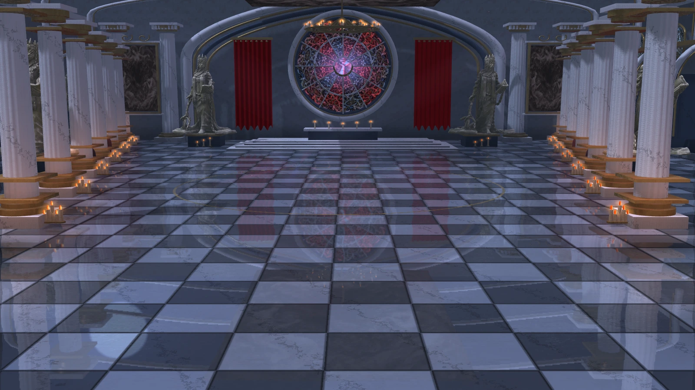
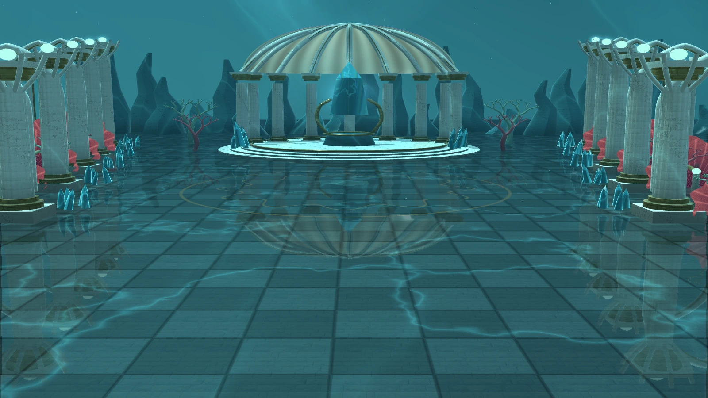
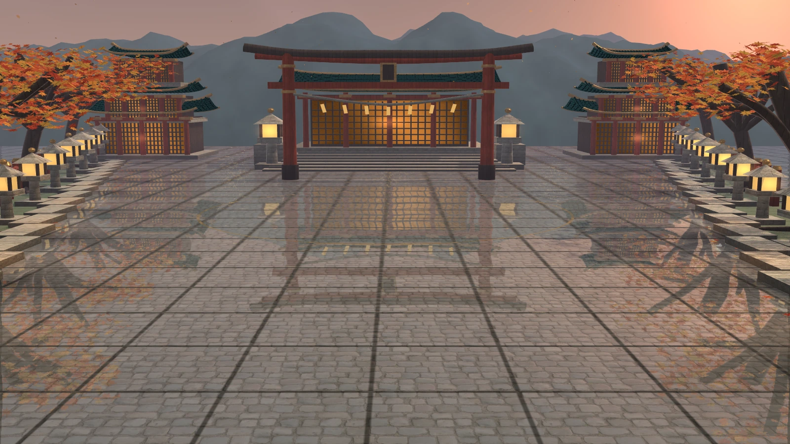

# D3 UCG GAME — 規格書（Three.js 網頁版 · 第一階段）

> 參考來源：`D:\GIT_TMD\Git_1\DragonTycoon3`（Cocos2d-x 3.x + Lua，以下稱「原版」）
> 文件版本：v0.1 · 2026-11-17

---

## 0. 目標與範圍

把原版「恐龍捕魚」的**核心戰鬥畫面**移植到瀏覽器（Vite + TypeScript + three.js），畫面接近原版雪地場景截圖。

### 0.1 本階段要做（In Scope）

| 項目 | 內容 |
|---|---|
| 場景 | 雪地場景 `Scene03`（SceneType Snow = 2），原版相機參數 1:1 |
| 龍（魚） | 第一批 14 種一般龍 + 帝王暴龍（BOSSSHOW 示範），c3b 模型、骨骼動畫、平面陰影 |
| 路徑 | **翻譯原版路徑腳本**（`PathData.json` / `GroupData.json` + `PathMove.lua` + `FishTimeline`），龍走在原版該走的位置 |
| 砲台 | `dt3_cannon_A` 3D 砲台、觸控瞄準、開火動畫、砲口 EFK、過熱發光 |
| 射擊 | 子彈（Fireball EFK）、牆面反彈、2D OBB 碰撞、自動射擊 |
| Shader | 魚身 unlit + 受擊 rim 白閃（bleach）、平面陰影（stencil）、場景 alpha-test |
| EFK | EffekseerForWebGL 1.70e，與 three.js 共用 GL context 與相機 |
| 表演 | 受擊白閃+抖動、一般死亡、得分跳字、**獎圈（WinCircle）**、**噴錢（Coin Spray）** |
| 假 Server | 瀏覽器內模擬：開房、群組排程、扣款、命中判定，**RTP 110%** |
| HUD | 座位面板（押注 / 餘額 / ± 按鈕）、等待加入、自動按鈕 |

### 0.2 本階段不做（Out of Scope，但架構需預留）

- BossShow 全部（`BossShowLayer` 系列）→ 依 §7.2 **降級為小獎**
- 特殊子彈（Grenade / Plasma / Laser）、鎖定射擊、道具掉落（`Reward_Item`）、HitMore、Overlay 大獎
- 換場景 / 轉場（Iris / Cloud）、天空場景（→ §15 已加入：debug 換場景、Iris、空中(黃昏)；§16 加入殭屍專案 監獄 / 墓地；雲層轉場仍未做）
- 真實 Server、帳號、多人同步（其他座位顯示「等待加入」）
- **抽卡（Gacha）** → 下一階段，以 Feature 外掛方式加入（§10）

---

## 1. 技術選型

| 類別 | 選擇 | 備註 |
|---|---|---|
| 建置 | Vite 8 + TypeScript 7（strict） | `npm run dev` / `build` / `test` |
| 3D | three.js 0.187 | WebGL2，`stencil: true`，不做色彩管理（與 Cocos 相同） |
| 特效 | EffekseerForWebGL **1.70e**（wasm） | 原版 efk 為 v1500（1.5），向下相容；放 `public/lib/effekseer/` |
| 模型 | 自寫 `C3bParser` + `C3bLoader`（c3b v0.7） | 原版沒有 FBX/glTF 原始檔，只能直接讀 c3b |
| 2D 圖集 | TexturePacker plist（format 2）→ 複製時轉 JSON | `Sprite2D`（支援 rotated / trim） |
| 數字字型 | BMFont `.fnt`（文字格式） | `BitmapText` |
| 測試 | Vitest | 路徑內插、群組時間軸、RTP 收斂 |
| 音效 | Web Audio（`AudioManager`） | mp3 |

---

## 2. 座標系與相機（與原版 1:1）

- **世界座標 Z 朝上**，地面 = `z = 0` 平面；路徑 `(x, y)` 直接是世界 XY。程式啟動時設定 `Object3D.DEFAULT_UP = (0,0,1)`。
- **不翻轉座位視角**（原版 `isReverse = false`，所有座位共用同一台相機）。
- Cocos 歐拉角換算：`q = Rz(-z)·Ry(y)·Rx(x)` → three.js `rotation.set(rad(x), rad(y), -rad(z), 'ZYX')`。共用工具 `cocosEuler()`。
- 設計解析度：**高固定 640**，寬 = 視窗寬 / 縮放（原版 FIXED_HEIGHT / SHOW_ALL）。

| 相機 | 值 | 來源 |
|---|---|---|
| 類型 | Perspective，**fov 33（垂直）** | `DisplayLayer.lua:8-17` |
| near / far | 10 / 5000 | 同上 |
| position | `(0, -104, 95)` | 同上 |
| rotation | `(60, 0, 0)`（不用 lookAt） | 同上，視線 `(0, 0.866, -0.5)` |
| 震動 | MoveBy `(d,0,d)`,`(-2d,0,-2d)`,`(0,0,2d)` 每步 0.05s | `DisplayLayer.lua:57-70` |

可見地面範圍（z=0）：近邊 y=-14（±82），遠邊 y=292（±253）。
**牆（子彈反彈）多邊形**：`(-65,-14) (-123,150) (123,150) (65,-14)`（`PhysicsDefine.lua:39`）。

### 2.1 繪製順序（Render Pipeline）

```
1. World3D pass   場景(不透明) → 魚陰影(blend+stencil) → 魚身/砲台(不透明)
2. EFK pass       effekseer.draw()（共用 depth，畫在模型之後）→ renderer.resetState()
3. Overlay2D pass 正交相機（設計座標，左下原點）：跳字、金幣、獎圈、命中特效
4. DOM HUD        座位面板、按鈕
```

`Stage` 以「可插拔的 RenderPass 陣列」實作，之後抽卡的 3D 卡牌展示可插入自己的 pass。

---

## 3. 專案結構

```
D3_UCG_GAME/
├─ docs/                    規格與說明
│  └─ SPEC.md
├─ tools/                   開發工具（Node 腳本，不進 bundle）
│  ├─ copy-assets.mjs       依 manifest 從原版複製資源；追 efk/efkmat/c3b 相依貼圖；plist→json
│  ├─ asset-manifest.mjs    要複製的資源清單
│  ├─ lib/lua-table.mjs     Lua table literal 解析（原版 *EfkSetting.lua → JSON，§14.2）
│  └─ inspect-c3b.mjs       c3b 結構 dump（除錯用）
├─ public/
│  ├─ lib/effekseer/        effekseer.min.js + effekseer.wasm
│  └─ res/                  複製來的原版資源，**保留原版相對路徑**（設定檔可直接抄原路徑）
├─ src/
│  ├─ main.ts               入口
│  ├─ app/                  組裝層：GameApp、啟動流程、Feature 清單
│  ├─ core/                 與渲染無關的框架
│  │  ├─ events/            EventBus（型別安全）
│  │  ├─ services/          ServiceRegistry（依 token 取服務）
│  │  ├─ feature/           GameFeature 介面、FeatureManager（擴充機制）
│  │  ├─ tween/             Action / ActionManager（對應 cc.Action：Sequence / Spawn / Delay / Repeat）
│  │  ├─ pool/              物件池
│  │  └─ math/              cocos.ts（歐拉角、角度）、geom2d.ts（OBB、牆）、random.ts
│  ├─ engine/               three.js 渲染層
│  │  ├─ stage/             Stage（renderer、相機、RenderPass、設計座標換算）
│  │  ├─ loaders/           C3bParser（純資料）、C3bLoader（→ three）、FntLoader
│  │  ├─ assets/            AssetManager（路徑、快取、atlas、字型、預載）
│  │  ├─ csd/               Cocos Studio 執行環境：CsdParser（XML→JSON）、CsbParser（FlatBuffers→JSON），工具共用；CsdPlayer（節點 + timeline）
│  │  ├─ input/             PointerRouter（UI 按鈕優先、其餘交給射擊）
│  │  ├─ effekseer/         EfkSystem（runtime 載入、播放、跟隨節點、併發上限）
│  │  ├─ materials/         FishMaterial、ShadowMaterial、CannonMaterial
│  │  ├─ sprite2d/          Sprite2D、BitmapText
│  │  └─ audio/             AudioManager
│  ├─ net/                  通訊抽象（真/假 server 共用）
│  │  ├─ protocol.ts        訊息型別（沿用原版訊息名稱）
│  │  ├─ Transport.ts       介面 + WebSocketTransport（預留）
│  │  └─ NetClient.ts       型別安全收發
│  ├─ server-fake/          假 Server（之後接真 server 時整包移除）
│  │  ├─ FakeServer.ts      模組化 server 核心（訊息分派、tick、use(module)）
│  │  ├─ LocalTransport.ts  頁內傳輸（模擬延遲、保序）
│  │  ├─ ugc/               UGC：ProfileStore（存檔）、WorldModule（房間目錄）、GachaModule、HomeModule、npcHomes（SPEC-UGC）
│  │  ├─ modules/           RoomModule（目前房間 / 輪替）、ScriptModule、ShootModule、DebugModule
│  │  ├─ rtp/               RtpEngine（目標 RTP 110%）、統計
│  │  └─ config/            scheduleConfig（群組排程）、payoutConfig（賠付表）
│  ├─ game/                 遊戲本體（對應原版 System / Model / View）
│  │  ├─ GameContext.ts     context、事件表、圖層
│  │  ├─ Tokens.ts          服務 token
│  │  ├─ define/            翻譯自原版 Define：Display / Fish / Cannon / Bullet / Scene / Reward / Sound
│  │  ├─ ugc/               UGC 規則（純邏輯，client 與假 server 共用）：魚卡、培養、抽卡、家園、裝飾物、掉券、協定（SPEC-UGC §11.1）
│  │  ├─ path/              PathMove 翻譯：PathTrack（cardinal / bezier / wait marker）、PathTypes
│  │  ├─ timeline/          FishTimeline / SubTimeline（群組時鐘、晚加入快轉）
│  │  ├─ systems/           SeatSystem、FishSystem、ShootingSystem、RewardSystem（+ SmallWinShow）、
│  │  │                     SkillSystem（按鈕狀態 / 互斥 / 子彈類型）、LockSystem（鎖定目標、準心）
│  │  ├─ bullet/            子彈行為（BulletBehaviorRegistry）：NormalBullet、TrackBullet、LightningBullet、LaserShot
│  │  ├─ world/             BGScene、Fish、FishEfkPlayer、FishClassRegistry、Cannon（多外觀）、CameraShake
│  │  │  └─ fishes/         各魚類別（對照原版 FishClassType）：TRex、TreeGoblin、Scorpion、Quetzalcoatlus、
│  │  │                     AzureDragon、AzureDragonWing、DragonSlainKnight（§14.4）
│  │  └─ show/              KillShowRegistry、FishHitShow、FishKilledShow、JumpNumber、
│  │                        WinCircle、WinCircleManager、CoinSpray、BulletHitFx、Tweens
│  ├─ ui/                   DOM HUD：UIRoot（設計座標圖層）、Hud（座位面板、房間）；
│  │                        SkillPanel（右側技能按鈕，overlay 載入原版 Card.csd）
│  └─ features/             可插拔功能
│     ├─ debug/             出獎模式開關、召喚魚選單、場景、相機、UGC 測試工具（§13.7）
│     ├─ ugc/               UGC 家園：UgcClient、ui/（功能列 + 房間 / 魚卡 / 抽卡 / 家園面板）、decor/（裝潢）、fx/（SPEC-UGC）
│     └─ (bossShow/ 之後)
└─ tests/                   Vitest
```

### 3.1 分層規則

- `core` 不 import three；`engine` 不 import `game`；`game` 不 import `server-fake`。
- `game` 只透過 `NetClient` 與 server 溝通 → 換真 server 只換 `Transport`。
- 跨系統溝通走 `EventBus`；擴充點走 **Registry**（§9）。

---

## 4. 資源管線

### 4.1 複製（`npm run assets`）

`tools/copy-assets.mjs` 讀 `asset-manifest.mjs`，從 `DragonTycoon3Resource/` 複製到 `public/res/`（相同相對路徑），並：

1. **c3b**：解析材質區塊取得貼圖檔名，連同同名 `.jpg` 一起複製。
2. **efk / efkmat**：掃描檔內 UTF-16 字串取得相依貼圖 / 模型 / 材質；同目錄找不到時以檔名在整個資源樹搜尋，複製到 efk 期望的位置。
3. **plist**：轉成 `*.plist.json`（frames + meta），runtime 不必解析 XML。
4. 輸出 `public/res/manifest.json`（檔案清單，給預載用）。

### 4.2 第一批資源清單

| 類別 | 檔案 |
|---|---|
| 資料 | `Data/PathData.json`、`GroupData.json`、`FishData.json` |
| 場景 | `Models/Scene/Scene03/*`（Scene3.c3b、scene3.jpg、scene3_object.jpg） |
| 龍 1-11 | `Models/Dinosaur/` Egg_01、Egg_02、Egg_Dragon_01、D_Dragon_01、A_Dragon_01、T_Dragon_01（+T_Dragon_02.jpg）、A_Tiger_01、A_Tiger_06、S_Dragon_02、Pterosaur/* |
| 龍 12-14 | 依 `FishDefine.lua` 對應模型 |
| Boss | `Models/Dinosaur_dt3/1_Boss/dt3_boss_005/*`（帝王暴龍） |
| 砲台 | `Models/Character/MountSkin/dt3_cannon_A.*` + shader 貼圖 |
| EFK | `Effekseer/Fireball.efk`；`Effekseer_dt3/Cannon/gunfire_A`、`gunfire_sparkSmoke`、`gunfire_smokeEnd`（+相依） |
| 圖集 | `DinosaurExport/plist/` Coin、Reward_common、Reward_common_D3_1、Effect、FX、MainUI |
| 字型 | `DinosaurExport/fonts/` number_20、number_20_w、d3_num_jp01 |
| 音效 | `Sound/mp3/sound/` C_1、C_2、C_3、se_05A、se_51、se_28E；開砲音、BGM（依 SoundDefine） |

### 4.3 C3bLoader（c3b v0.7）

依 Cocos `Bundle3D::loadBinary` 格式解析：

- Header `C3B\0` + version(2 bytes) + reference table（id / type / offset）。
- **Mesh**：attribute 清單（POSITION / NORMAL / TEX_COORD / BLEND_WEIGHT / BLEND_INDEX…）→ interleaved float；每個 mesh part 一組 `uint16` index + AABB。
- **Material**：id、14 floats、texture 清單（檔名、wrap）。
- **Node**：遞迴；`skeleton` 旗標；part（subMeshId、materialId、bones[]、invBindPose[]）。
- **Animation**：每骨骼 keyframe（`keytime` 為 0..1 正規化 × totalTime；flag bit0 旋轉、bit1 縮放、bit2 位移）。

轉換規則：
- 骨架 → `THREE.Bone` 樹，掛在模型根節點下；每個 part 一個 `SkinnedMesh`，自己的 `Skeleton`（bones 子集 + invBindPose）。
- 綁定用 **attached 模式 + `bind(skeleton, identity)`**，等同 Cocos `palette = boneWorld(相對模型根) × invBindPose`。
- 有骨骼 part 的節點 transform 套到模型根（Cocos `Sprite3D::createNode` 行為：之後設定會覆寫位置/旋轉，僅保留縮放）。
- UV 不翻轉（Cocos shader 做 `v = 1 - v`，等同 three 預設 `flipY = true`）。
- 動畫：整條 take 一個 `AnimationClip`，再依設定 **30fps 影格區間**切子 clip（`Animate3D::createWithFrames`）。
- Loader 回傳「原型」，實例用 `SkeletonUtils.clone`；`AssetManager` 以副檔名分派 loader，未來可加 glTF。

---

## 5. 遊戲物件規格

### 5.1 場景 BGScene

- 模型 `Scene3.c3b`，`rotation (90,0,0)`（Y-up 模型 → Z-up 世界），位置原點、不縮放。
- 材質：unlit 貼圖 × `u_color`，`alphaTest 0.3`，強制寫深度（原版 `sceneTest` technique）。
- 陰影色（Snow）：`(0.145, 0.145, 0.337)`，提供給魚陰影。
- `SceneDefine` 以表格保留其他場景（Forest/Desert…）欄位，本階段只載入 Snow。

### 5.2 龍（Fish）

#### 設定（翻譯自 `FishDefine.lua`）

`FishModelSetting`：`model`、`texture?`、`spriteScale`、`spriteRot`（預設 `(90,0,180)`）、`spriteOffset`、`colliderScale{x,y}`、`hitBox{scale,offset}`、`isFlying`、`runAnimation[]`、`animations{name:{start,end,speed}}`；
`FishCommonSetting`：`hitShakeType`（Small/Middle/Big）、`waitAction[]`；
`FishRewardSetting`：`image`（獎圈頭像）、`winCircle[showType]`；
`FishKillShowSetting`：`bossShowType`。

| # | 名稱 | 模型 | scale | Run 影格 | 賠率 |
|---|---|---|---|---|---|
| 1 | 幼幼龍 | Egg_01 | 1.76 | 0–30 | 2 |
| 2 | 蛋蛋龍 | Egg_02 | 1.76 | 0–18 | 3 |
| 3 | 蛋殼龍 | Egg_Dragon_01 | 1.496 | 0–20 | 4 |
| 4 | 迅猛龍 | D_Dragon_01 | 5.28 | 0–24 | 5 |
| 5 | 冠龍 | A_Dragon_01 | 0.792 | 0–48 | 6 |
| 6 | 三角龍♂ | T_Dragon_01 | 0.88 | 0–20 | 8 |
| 7 | 三角龍♀ | T_Dragon_01 + T_Dragon_02.jpg | 0.792 | 0–20 | 9 |
| 8 | 劍齒虎 | A_Tiger_01，rot(180,0,180) | 0.5544 | 0–20 | 10 |
| 9 | 黃金劍齒虎 | A_Tiger_06，rot(180,0,180) | 0.792 | 0–20 | 50 |
| 10 | 黃金劍龍 | S_Dragon_02 | 8.8 | 0–50 | 60 |
| 11 | 翼龍 | Pterosaur，rot(90,0,0)，offset(0,0,10)，飛行 | 0.88 | 0–30 | 100 |
| 12–14 | 刺甲龍 / 太古劍龍 / 棘龍 | 依 FishDefine | | | 800 / 900 / 1000 |
| 24 | 帝王暴龍（BOSSSHOW） | dt3_boss_005 | 0.2376 | Walk_1 2290–2362 等 | 30000 |

#### 節點結構

```
FishNode (Group)         位置 = 路徑 (x,y,0)；rotation.z = 朝向；scale = spriteScale × 3
└─ SpriteNode            rotation = spriteRot（cocosEuler）；position = spriteOffset
   ├─ SkinnedMesh(es)    FishMaterial
   └─ Shadow mesh(es)    ShadowMaterial（共用 geometry / skeleton）
```

#### 碰撞 / 選取

- 子彈碰撞：**地面 XY 平面的 OBB**；大小 = 模型 AABB(x,y) × `colliderScale` × 節點縮放，跟著 Z 旋轉。
- 3D hitBox（`hitBox.scale/offset`）保留給之後的點選鎖定。

### 5.3 路徑翻譯（`PathMove.lua` → `game/path/PathTrack.ts`）

把整條路徑先編譯成「分段時間軸」，以 `evaluate(t)` 直接求位置（可任意快轉，不必像 cc.Action 逐幀推進）。

**起點**：`wp[0].(x,y)`。
**每個 waypoint 依序產生**：

1. `MoveTo(wp.duration, wp.xy)`：從上一段終點線性移動；`duration = 0` 視為瞬移。
2. `wait > 0` → `Wait(wp.wait)`（若 `wait == waitAction.checkTime` 完全相等：開始時播 `ani`、結束時播 `nextAni`）。
3. `spline` 存在：
   - 一般：**Cardinal Spline**（`cc.CardinalSplineTo`），`tension = spline.tangent`（資料全為 0 → 均勻 Catmull-Rom），**每段時間均分**（忽略 `pt[].duration`），使用絕對座標（`pt[0]` 與當前位置不同會瞬移，原版即如此）。
   - 若 `pt[1..]` 任一點 `wait > 0`：改為**逐段三次 Bézier**，`f = (1 - tangent)/6`，`c1 = p1 + (p2 - p0)·f`、`c2 = p2 - (p3 - p1)·f`，每段時間 `pt.duration ?? spline.duration/(n-1)`，段後接 wait。

Cardinal 公式（`CCActionCatmullRom.cpp`）：

```
deltaT = 1/(n-1); p = floor(t/deltaT); lt = (t - deltaT·p)/deltaT   // t==1 → p=n-1, lt=1
P0..P3 = pts[clamp(p-1 .. p+2, 0, n-1)]
s = (1 - tension)/2
b1 = s(-t³+2t²-t); b2 = s(-t³+t²)+(2t³-3t²+1); b3 = s(t³-2t²+t)+(-2t³+3t²); b4 = s(t³-t²)
pos = P0·b1 + P1·b2 + P2·b3 + P3·b4
```

**不使用的欄位**（原版 client 也沒用）：`IsBezier`、`speed`、`z`、path-level `duration`、`FishData.SwimSpeed`。

**朝向**（`PathMove:UpdateTransform`）：每幀 `dir = pos - lastPos`；`|dir|² ≤ 0.001` 時不轉向也**不更新 lastPos**；否則 `angle = atan2(dir.x, dir.y)`（自 +Y 順時針），three.js `rotation.z = -angle`。飛行龍在天空場景另有傾斜公式（本階段不用）。

路徑走完但尚未到 `deltime` → 停在終點等待（原版行為）。

### 5.4 群組時間軸（`FishTimeline` → `game/timeline/`）

- `GroupData[groupId] = [{fish, path, delay, duration}]`，`fish` 為 **0-based**（type = fish + 1），群組內魚編號 = 陣列順序。
- 魚序號 `serial = groupIndex × 1000 + fishIndex`（與原版一致）。
- 每個 `SubTimeline` 有自己的時鐘；`addtime = delay`、`deltime = delay + duration`；群組在 `max(deltime) + 0.1s` 結束。
- **晚加入 / 同步**：收到 `{groupIndex, groupId, timeline(ms), deadFishes}` → 群組時鐘設為 `timeline/1000`；已過 `deltime` 的魚不生；存活魚 `pathTime = elapsed - delay` 直接 `evaluate`。`deadFishes` 不生。時間只快轉不倒退。
- `deltime` 到 → 直接移除（無動畫）。

### 5.5 砲台（Cannon）

| 項目 | 規格 |
|---|---|
| 模型 | `dt3_cannon_A.c3b`，`spriteRot (90,0,0)`，動畫 30fps：Idle 0–15（loop）、Atk 15–19 |
| 座位 | 3 席，螢幕錨點 `(W/2-320, 44.9)`、`(W/2, 44.9)`、`(W/2+320, 44.9)` → 射線投到 z=0 ≈ `(-39.1,-6.6)`、`(0,-6.6)`、`(39.1,-6.6)`；本人 = seat 0 |
| 瞄準 | 觸控點投到 z=0；`angle = atan2(dx, dy)`（自 +Y 順時針，deg），**clamp ±90°**；`rotation.z = -angle`；只在按住時轉 |
| 開火 | 每發播 Atk 一次後回 Idle；砲口骨骼 `GunFire` + offset (0,2,0) 播 `gunfire_A.efk`（scale 0.5，0.6s） |
| 過熱 | `fireFactor += 0.05`/發（上限 1.0）；每 5 發且 > 0.8 播 `gunfire_sparkSmoke`（0.75）；停火 0.32s 後若 > 0.4 播 `gunfire_smokeEnd`（1.5）；再 0.15s 後以 1/s 衰減；shader 依 fireFactor 加熱光 |
| 押注 | 押注表由 server 給；±1 格、兩端夾住；不影響砲台外觀；扣款 = bet × costRate（Normal = 1） |

### 5.6 子彈（Bullet）

| 項目 | 規格 |
|---|---|
| 視覺 | `Effekseer/Fireball.efk`，節點 scale 0.5，離地 2（`GroundDist`） |
| 起點 | 砲口骨骼世界座標沿相機射線投到 z=0 |
| 速度 | 170 單位/秒，方向 `(sin a, cos a)` |
| 射速 | `ShootCD` 0.12s；按住連射、點一下單發；自動模式同 CD |
| 反彈 | 撞牆多邊形 → 以法線翻轉速度軸（`|n.x|>0.5` 翻 x、`|n.y|>0.5` 翻 y）；**第 3 次碰牆消失**（存活 < 0.5s 例外） |
| 壽命 | 35s；每 1s 移除牆外子彈 → 送 DUD |
| 碰撞 | 子彈 OBB 10×10×0.5×0.5 vs 魚 OBB（XY 平面）；命中一隻即消失 → 送 HIT、播受擊表演、播命中特效 |
| 命中特效 | `Fire_Normal_Hit`（原 csb）→ 以 `Effect.plist` 影格重做的 billboard 序列幀，scale 0.1 |
| 上限 | 同時 30 發（原版沒生效，此版生效） |

### 5.7 Shader / 材質

| 材質 | 對應原版 | 內容 |
|---|---|---|
| `FishMaterial` | `shader_3d_skin_position_tex` + `shader_3d_color_tex` | unlit：`tex × u_multColor + (1 - u_color)`，alpha × `u_color.a`；**bleach**：`mix(c, vec3(scalar), rate × pow(1 - n·v, pow))`，預設 pow 3.5 / scalar 1.7 |
| `ShadowMaterial` | `shader_3d_skin_position_tex_z0` + `shader_3d_shadow` | 世界座標 `x -= z·0.3; y += z·0.8; z = min(0.1, z)`；色 = 場景陰影色、alpha 0.45；depthWrite off；**stencil 128 NOTEQUAL/REPLACE** 防重疊變深 |
| `SceneMaterial` | `ground.material: sceneTest` | 貼圖 × u_color，alphaTest 0.3（預留 Iris 轉場 uniform） |
| `CannonMaterial` | `normal_matCap_mask_changeTexture` | 貼圖 + 過熱貼圖（`u_fireFactor`）+ 法線貼圖擾動的 matcap（reflectivity 1.0、normalFactor 0.8） |

全部用 `ShaderMaterial` + three 內建 skinning chunks。場景無燈光（原版也沒有）。

### 5.8 EFK（`engine/effekseer/EfkSystem.ts`）

- 啟動時 `initRuntime(wasm)` → `createContext().init(renderer.getContext())`。
- 每幀：`update(dt × 60)` → three render 後 `setProjectionMatrix(camera.projectionMatrix)`、`setCameraMatrix(camera.matrixWorldInverse)`、`draw()` → `renderer.resetState()`。
- API：`play(setting, attachTo?: Object3D)` → `EfkHandle`。`setting = {file, position, rotation, scale, speed, duration(預設 3, -1=loop), delay, maxConcurrent(預設 6)}`（對應原版 `EFK_SETTING`）。
- 跟隨：有 `attachTo` 時每幀 `handle.setMatrix(attachTo.matrixWorld × local)`（原版 emitter = 節點世界矩陣）。
- 效果快取 + 每檔併發上限；`stop()` 後釋放。

---

## 6. 假 Server

### 6.1 通訊

- `Transport` 介面：`send(msg)`、`onMessage(cb)`；`LocalTransport` 以 `setTimeout` 模擬 20–60ms 延遲並 JSON 複製（確保不共享物件參考）。
- 訊息沿用原版名稱 / ID（精簡欄位）：

| 方向 | 訊息 | 主要欄位 |
|---|---|---|
| C→S | `U2G_LOGIN_REQ` | — |
| S→C | `G2U_ROOM_DATA_NOTIFY` | `yourseat, sceneType, seats[], betList, timeline` |
| C→S | `U2G_SYNC_SCRIPT_REQ`(106) | — |
| S→C | `G2U_SYNC_SCRIPT_ACK`(106) / `G2U_ADD_GROUP_SYNC_NOTIFY`(107) | `timeline, list:[{groupIndex, groupId, timeline, isPause, deadFishes}]` |
| C→S | `U2G_SHOOT_REQ`(104) | `bulletId, bulletType, bet, angle` |
| S→C | `G2U_SHOOT_NOTIFY`(104) | `seat, bulletId, bet, angle, seatMoney` |
| C→S | `U2G_HIT_REQ`(55) | `bulletId, scriptIdDataVec:[{groupIndex, fishIndex}]` |
| C→S | `U2G_DUD_REQ`(56) | `bulletId` |
| S→C | `G2U_KILL_FLOATODDS_FISH_NOTIFY`(118) | `seatIndex, scriptIdData, fishType, showType, money, seatMoney, bet, floatedOdds, floatedRate, unDead, killIndex` |

### 6.2 模組

- **RoomModule**：單人房、3 席（本人 seat 0，其餘空）、初始餘額 31,708,504、押注表 `[10, 50, 100, 500, 1000, 5000]`、場景 Snow。
- **ScriptModule**（原版排程程式碼不在 repo，以下為自訂設定，可調）：

| Kind | 間隔 | 候選群組（權重） |
|---|---|---|
| small | 4s | 只含魚 1–9 的群組 |
| medium | 15s | 含魚 10–11 的群組 |
| big | 45s | 含魚 12–14 的群組（20–25） |
| boss | 120s | 群組 35（帝王暴龍） |

  開場依 20–40s 偏移回填（模擬進入時場上已有魚）；`groupIndex` 用空槽重複利用；伺服器端追蹤每隻魚存活窗 `[delay, delay+duration)` 與死亡名單。
- **ShootModule**：開砲扣 `bet × costRate`（餘額不足拒絕）；HIT 查子彈與魚是否有效 → 交給 RtpEngine；DUD 退款（可設定）。

### 6.3 RTP 110%

每條魚有賠付結果表 `outcomes: [{showType, rate, weight, unDead, odds?}]`：

```
E = Σ(weight × odds × rate) / Σweight          // 期望賠率
P(中獎) = min(1, RTP / E)                       // RTP = 1.10
中獎 → 依 weight 抽一個 outcome → money = bet × odds × rate
```

每顆命中的子彈期望回收 = 1.10 × bet。`RtpEngine` 累計投注 / 派彩 / 實際 RTP 給 debug 面板；Vitest 以 100 萬次模擬驗證收斂在 110% ± 1%。

| 魚 | outcomes（第一版） |
|---|---|
| 1–8 | `{showType 1, rate 1}` |
| 9–11 | `{showType 1, rate 1}` → 獎圈 Middle |
| 12–14 | `{1, ×1, w70}`、`{2, ×5, w20}`、`{3, ×10, w9}`、`{4, ×100, w1}` → 獎圈 Big + 倍數字 |
| 24 帝王暴龍 | `{1, odds 30, unDead, w95}`（小獎不死）、`{3 = BOSSSHOW, odds 300, w5}`（死亡） |

---

## 7. 擊殺表演

### 7.1 分派（`KillShowRegistry`）

```
收到 118 KILL_FLOATODDS
  fish = alive[serial]；找不到 → 只更新餘額
  isBossShow = (fishKillShow.bossShowType != null && showType == bossShowType)
  handler = isBossShow ? registry.bossShow(fishType) : registry.get(fishType)
  handler 不存在 → SmallWinShow（預設）
SmallWinShow(content):
  if winCircle(fishType, showType) != None → 獎圈（座位）
  else                                      → 跳字「+N」（魚的位置）
  噴錢（money > 0）
  if !unDead → 魚死亡表演；else 魚繼續走
```

### 7.2 BOSSSHOW 降級規則

本階段**不註冊任何 BossShow handler**，所以 `showType == bossShowType` 一律走 `SmallWinShow`：
- `unDead = false` → **小獎 + 死亡**（Big 獎圈 + 噴錢 + 死亡表演）
- `unDead = true`  → **小獎不死**（獎圈 / 跳字 + 噴錢，魚繼續走路徑）

之後做 BossShow 時只要 `registry.registerBossShow(24, TRexBossShow)`，不用改分派流程。

### 7.3 受擊（`FishHitShow`，只對本人子彈）

- Bleach：每 0.05s 一步、共 5 步，`rate = 1 - (1 - p)²`（0.36→1.0），結束歸 0；進行中不重觸發。
- 抖動：沿本地 X `+off, -2off, +off` 再回原位；Small 0.2/0.1s/×2、Middle 0.1/×1、Big 0.02/×1；0.3s 冷卻。

### 7.4 死亡（`KilledShowNormal`）

停止路徑；Run 動畫 2 倍速 loop；
`0–0.2s` z +15 → `0.2–0.4s` scale ×1.1 → `0.4–0.6s` z -15，同時 `0.4–0.7s` 淡出 → `0.9s` 回收。無特效、無音效。

### 7.5 跳字（無獎圈時）

字型 `number_20.fnt`，文字 `+1,234`，位置 = 魚 hitBox 中心投影 −10y，scale 0.8：
`Delay 0.3 → MoveBy(0.5, (0,30)) → Delay 0.3 → FadeOut 0.3`（共 1.4s）。

### 7.6 獎圈（WinCircle）

| 類型 | 底圖（Reward_common） | 用途 |
|---|---|---|
| Min | `Reward_Small.png` | （保留） |
| Middle | `Reward_Middle.png` | 魚 9–11 |
| Big | `Reward_Big01.png` + `reward_big1.png` + 倍數字 `5/10/100TimesReward_word.png` | 魚 12–14、BOSSSHOW 降級 |

- **直接播原版 csb**：`DinosaurExport/reward/Reward_Min_0 / Reward_Middle_0 / Reward_Big_0.csb`，由 `CsbParser` 轉成 json、`CsdPlayer` 播放（§13.6），節點、圖片、光暈、星星、粒子、爆光子動畫（`ExplosionNode` → `main/Death_Explosion_big_Anim.csb`）都與原版一致。
- 程式只做原版 `WinCircleCommon:show` 做的事：`img` 換成魚頭像 `D3_xx.png`、`num` 設金額、`MegaAward` / `MegaAward_light` 換倍數字並顯示（沒有暴獎則隱藏）、別人的獎圈 opacity 150、`ExplosionNode` 從頭播一次後隱藏。
- 位置：**本人座位錨點**（不在魚身上），整體 scale 0.8（別人 0.6）；同座位最多 6 個，槽位偏移 `(0,0) (-120,-30) (120,-30) (0,90) (-120,60) (120,60)`。
- 動畫（60fps）：`start`（0–45）播完停在最後一格（原版不播 `loop`）→ 該座位最後一個獎圈出現 **1.5s 後**全部播 `end`（115–135）後移除；沒有 `end` 的才 ScaleTo(0.3, 0)。
- 數字**不滾動**，直接設值（原版即如此）。
- 音效：Small/Middle/Big → `C_1/C_2/C_3`；Big 時相機震動 3 次、0.8。

### 7.7 噴錢（CoinSpray）

金幣：`Coin.plist` `dt3_ef_coin_01..10`，0.07s/幀 loop，43×43，Overlay2D。目標 = 本人砲台座標。

| 條件（floatedOdds） | 模式 |
|---|---|
| < 10 | **Drop**：數量 `max(1, floor(min(money/bet, 30)/2))`；起點魚位置 + (±30, 0)；`Delay 0.1i → JumpBy(0.6, h50) → JumpBy(0.4, h25) → MoveTo(dist/1500)`；音效 `se_05A` |
| ≥ 10 / 90 / 10000 | **Explosion** 1 / 2 / 4 圈：每圈 `4/8/16/32` 枚，半徑 `30 + 45(ring-1)`；`EaseIn(MoveBy 0.105, 極座標, 0.3)` 同時 `JumpBy(0.42,h50) → JumpBy(0.21,h25)` → `Delay 0.056i` → `MoveTo(dist/2143)`；音效 `se_51` |

第一枚到達時在餘額欄位上方跳「+N」；餘額以 server `seatMoney` 為準。

---

## 8. HUD（DOM，設計座標 × 縮放）

- 底部 3 個座位面板：x = W/2 + (-320, 0, 320)。本人：押注框（數值）+ 餘額框（金幣圖示 + 千分位）+ `−` / `+` 按鈕；空位：「等待加入」。
- 右側：自動（toggle，同 ShootCD 連射當前角度）；其他按鈕先放外觀。
- 左上：房間名稱。
- 圖片優先使用 `MainUI.plist` 影格（`SpriteSheet → CSS background`），缺的用 CSS 樣式補。

---

## 9. 擴充機制

### 9.1 Feature（外掛）

```ts
interface GameFeature {
  readonly id: string;
  readonly deps?: string[];
  install(ctx: GameContext): void | Promise<void>;   // 註冊事件、UI、render pass、registry
  update?(dt: number): void;
  dispose?(): void;
}
// GameContext = { events, services, stage, assets, efk, audio, net, ui, registries }
```

`FeatureManager` 依 `deps` 排序安裝；`app/features.ts` 是唯一的開關清單。

### 9.2 Registry（擴充點）

| Registry | 狀態 | 用途 | 之後的擴充 |
|---|---|---|---|
| `FishClassRegistry` | ✅ | `fishClass` → Fish 類別（已有 `normal`、`trex`） | 其他 Boss 專用 Fish |
| `KillShowRegistry` | ✅ | fishType / bossShow → 表演 handler（預設 `SmallWinShow`） | `registerBossShow(24, TRexBossShow)` |
| `FakeServerModule` | ✅ | `server.use(module)`：訊息 → handler + tick | `GachaModule` |
| 協定 declaration merging | ✅ | `declare module '@net/protocol'` 加訊息 | 抽卡訊息 |
| `Stage.addPass` | ✅ | 插入自訂 render pass | 抽卡 3D 展示 |
| `BulletBehaviorRegistry` | ✅ | 子彈 kind → 行為（track / lightning / laser） | 新特殊子彈 |
| `CsdLibrary` | ✅ | 載入原版 csd 動畫（§13.6） | 抽卡卡牌、BossShow |
| `SceneRegistry` | 預留 | sceneType → 場景建構 | 其他場景、轉場 |

### 9.3 資源 Bundle（預留）

目前由各系統的 `preload()` 載入。之後加 `AssetManager.loadBundle(name, list)`；每個 Feature 宣告自己的 bundle，進入功能時才載入；`tools/asset-manifest.mjs` 也依功能分 group。

---

## 10. 下一階段：抽卡（Gacha）預留

> **已實作，併入 UGC 家園版**：抽卡、魚卡培養、玩家家園、裝潢見 [SPEC-UGC.md](SPEC-UGC.md)（§17）。以下是當初的預留設計，保留作紀錄。

- `features/gacha/`：`GachaFeature`（install 時註冊按鈕、面板、render pass）、`GachaSystem`（狀態）、`GachaView`（卡牌 3D 展示，可用原版 `Card.csb` / `ItemCard` 素材）。
- `server-fake/modules/GachaModule`：卡池、機率表、保底、扣款；訊息 `U2G_GACHA_DRAW_REQ` / `G2U_GACHA_DRAW_ACK`。
- UI 走 `UIRoot` 的 `panel` / `modal` 圖層，不碰戰鬥 HUD。

---

## 11. 里程碑

| # | 內容 | 驗收 | 狀態 |
|---|---|---|---|
| M0 | 規格、資料夾、Vite 骨架、資源複製工具 | `npm run dev` 開得起來；`npm run assets` 複製成功 | ✅ |
| M1 | Stage、相機、雪地場景、C3bLoader、龍 + 動畫 + 陰影 | 畫面角度與原版截圖一致 | ✅ |
| M2 | PathTrack、群組時間軸、假 server 排程 | 龍依原版路徑走；路徑 872 總長 149.28s 與群組一致 | ✅ |
| M3 | 砲台、瞄準、子彈、反彈、碰撞、EFK | 可射擊、子彈反彈、砲口 / 冷卻特效 | ✅ |
| M4 | RTP、受擊、死亡、跳字、獎圈、噴錢、BOSSSHOW 降級 | 完整擊殺流程；RTP 模擬 110% ± 1.5% | ✅ |
| M5 | HUD、自動、音效、debug 面板 | 畫面接近附圖 | ✅ |
| M6 | 魚種 15–17、22–28 + 魚身 EFK（§14） | 召喚每個群組都能正常走完路徑、可打、可擊殺 | ✅ |
| M7 | debug 場景下拉選單、空中(黃昏) 場景、場景限定魚種（§15） | 天空 flowmap 流動、轉場雙向正常；風神 / 蒼龍只在空中(黃昏) 出現與召喚 | ✅ |
| M8 | 殭屍專案 監獄 / 墓地 場景、依場景自動切換相機（§16） | 兩場景材質正確（墓地雲 / 月亮流動）、監獄門牆掛件；切到監獄 / 墓地相機自動換第二種、其他第一種；轉場不露底色 | ✅ |
| M9 | UGC 家園版（§17、[SPEC-UGC.md](SPEC-UGC.md)）：公有地 + 玩家家園、抽卡券 / 抽卡 / 培養、家園設定、抽成、裝潢 | Vitest 43 項 + 無頭瀏覽器實測全流程 | ✅ |

---

## 12. 已知差異 / 風險

| 項目 | 說明 |
|---|---|
| 原版排程演算法缺失 | `CasinoFishBase` 不在 repo，群組排程為自訂（`server-fake/config/scheduleConfig.ts`） |
| csb 動畫 | ~~three 無法讀 csb~~ → 已支援 csb（§13.6），獎圈改播原版 csb。命中特效 `Fire_Normal_Hit` 仍是序列幀重做 |
| 獎圈錨點 | 原版 SeatInfo `WinCircleAP` 座標未取得，暫定座位錨點上方 190（`WIN_CIRCLE_ANCHOR_OFFSET_Y`） |
| 魚碰撞盒大小 | 原版用 `Sprite3D` contentSize（引擎原始碼查不到賦值處）；此版用「模型在地面 XY 的範圍 × ColliderScale」，需要時微調 |
| 飛行魚 | 原版一般子彈不打飛行魚（需鎖定彈）。本階段沒有鎖定彈，改為可打，且碰撞中心取「模型中心沿視線投到地面」（`NORMAL_BULLET_HITS_FLYING`） |
| DUD 退款 | 沒打到魚的子彈（撞牆 3 次 / 出界 / 超時）假 server 會退款（`ShootModule.refundDud`） |
| 子彈上限 | 原版 30 發上限實際沒生效，此版生效 |
| c3b 多 part 共用頂點 | 各 part 骨骼表不同，three 自行算包圍體會越界 → 載入時以 c3b AABB 預設包圍體（`presetSkinnedBounds`） |
| 物件池 | 魚目前每次生成都 clone；之後可加池化（原版 `ModelMgr:pop/push`） |
| EFK 版本 | 少數舊版 efk（v13）未在第一批使用 |
| 效能 | 魚 SkinnedMesh 每隻獨立；之後可做 instancing / 動畫烘焙 |

---

## 13. 第二階段：技能按鈕、特殊子彈、測試工具

> 來源：原版 `Card.csd`、`SkillCtrlView.lua`、`SkillCtrlViewBase.lua`、`BulletDefine.lua`、`CannonDefine.lua`、
> `BulletLightning.lua`、`LockShootEffect.lua`、TMDCommon `TestSummonContent.lua` / `TestCheatModeContent.lua`

### 13.1 右側技能按鈕（原版 `main/Card.csd`）

- 位置：Main.csd 的 Card 節點 (1131, 150)，靠右下對齊 → x = W − 5、y = 150；按鈕 90×90、anchor (1, 0.5)。
- 直接用 CSD 執行環境（§13.6）載入 `Card.csd`，圖片、位置、子節點與原版一致。

| 按鈕 | 圖片（plist） | 功能 | 子彈類型 | 權重 |
|---|---|---|---|---|
| ImgBtn_1 橘·準心 | `Aim.png`（MainUI） | 自動瞄準（AutoShoot） | Lock | 1 |
| ImgBtn_2 紅·火箭 | `Torpedo.png`（MainUI） | 榴彈砲（Skill_1） | Focus | 2 |
| ImgBtn_4 紫·漩渦 | `Lightning_v2.png`（Bullet_dt3） | 紫雷擊＝擴散彈（Skill_3） | Advanced | 2 |
| ImgBtn_3 金·無人機 | `Drone.png`（MainUI） | 巡光炮（Skill_2） | LaserLock | 2 |
| ImgBtn_5 綠·自動 | `AIAuto.png`（MainUI） | 自動射擊（AIAuto） | Lock | 1 |

- 狀態：按下 0.2s 縮到 0.85、放開回 1；停用 = 灰 (128,128,128)；開啟 = 顯示 `ActEff`（原版粒子 `effect/Auto.plist`，以 `cannonef04_2.png` 旋轉光暈近似）與 `Cost`（`Block_6` + 金幣 + `number_7_0.fnt`，顯示「押注 × 倍率」）。
- 紫色按鈕常駐 `Card_lighting.csd`：關閉播 `idle_normal`、開啟播 `idle_click`（loop）。
- 規則（SkillCtrlView）：
  - 自動瞄準（1）與自動（5）互斥；三個技能（2、3、4）互斥；瞄準可以和技能同時開。
  - 子彈類型 = 開啟中權重最高者；全關 = 一般子彈（直線、會反彈）。
  - auto = 按鈕 1 或 5 開啟。
  - 手動技能（技能開、auto 關）：點到魚 → 鎖定，按住才射；點空白不射。

### 13.2 特殊子彈（SpecialBulletDefine）

| 類型 | 成本倍率 | ShootCD | 砲台外觀 | 限制賠率 | 行為 |
|---|---|---|---|---|---|
| None 一般 | 1 | 0.12 | A | – | 直線、撞牆反彈（第一階段） |
| Lock 鎖定 | 1 | 0.1 | A | – | 拋物線追蹤彈（Fireball.efk，速度 150），必中 |
| Focus 榴彈砲 | 5 | 0.25 | B | ≥ 6 | 拋物線追蹤彈（Weapon_Big_Bomb.efk，速度 200），必中；命中 `dt3_cannon_B_Hit`；**原版沒有範圍傷害** |
| Spread 雷擊 | 15 | 0.4 | C | – | 同 Advanced（原版沒有按鈕，保留定義） |
| Advanced 紫雷擊 | 20 | 0.4 | C + D 貼圖 | – | 擴散：主目標 + 範圍 60 內其他魚，共 3–6 條（§13.4） |
| LaserLock 巡光炮 | 30 | 0.4 | E + 無人機 ES | ≥ 16 | 雷射光束，每 0.4s 一次傷害（§13.5） |

- 追蹤彈拋物線（BulletPathMove3dTrack）：`movTime = max(dist/speed, 0.1)`、`h = 50 × movTime`；前半 `h·4t(1−t)`（t=u·0.5）、水平線性到中點；後半 `(1−t)·h`、水平 `0.5 + √t·0.5`；每幀重讀目標位置（追蹤）。
- 砲台外觀切換（CannonView）：A = Normal/Lock、B = 榴彈、C = 雷擊、C+`dt3_cannon_D.jpg` = 紫雷擊、E = 雷射；動畫 Idle 0–15、Atk 15–25（B/C/E）。
- 音效：Lock = MG_3、Focus = MG_4、雷擊 = MG_5、雷射 = MG_6、按鈕 = S_24、換鎖定目標 = L_4。

### 13.3 鎖定

- 自動選目標（BulletModel:LockFish）：目前目標還活著就保留；否則同種最近的魚；否則畫面內最高賠率（並符合限制賠率）。
- 點選（FishBase 3D 射線）：相機射線 vs 魚的 hitBox（OBB），多隻時取最高賠率；點到的魚優先。
- 準心 `main/LockAim_Anim.csd`：`start`（0–15）→ `loop`（20–80），每幀跟著魚的 lockPos 投影位置；換目標播 L_4。

### 13.4 紫雷擊（擴散彈）

- 目標：鎖定魚 + 距離 60 內其他可打的魚，總數 `random(2,5) + 1`（3–6 條）。
- 子彈 `Bullet_dt3/dt3_cannon_C_Bullet_purple.csd`（billboard），3D 直線 500/s 飛向主魚 lockPos。
- 命中：一個 `U2G_HIT_REQ` 帶全部目標；主魚播 `dt3_cannon_C_Hit_purple.csd`；主魚白閃 0.7s、其他 0.3s，依「與主魚的距離 / 60 × 0.3s」延遲（原版以世界原點算距離是 bug，此版改以主魚）；縮放脈動 ±4%（小魚 ±3%）。
- 被雷擊打死的魚依同樣延遲依序死亡。

### 13.5 巡光炮（雷射）

- 每 0.4s 一發（成本 押注×30），以 2D 直線 1000 px/s 計算抵達時間後命中。
- 光束 `Bullet_dt3/dt3_cannon_E_laser.csd`：放在砲口投影位置、轉向目標；`Line` 節點 scaleY = 長度 / 250、`Hit` 節點放在末端；每次射擊重設 3 次 `loop`（0–16），用完或 0.5s 沒射擊播 `end`（20–36）。
- 無人機 `dt3_cannon_ES.c3b` ×2 掛在骨骼 `dt3_cannon_ES_R / _L`（scale 2、rotation (−90,180,−90)）。

### 13.6 CSD 執行環境（`src/engine/csd/`）

- `tools/copy-assets.mjs` 把 Cocos Studio 原始檔 `.csd`（XML，位於 `TMD_CocosStudio_DragonTycoon3/CocosProject/cocosstudio`）轉成 `.csd.json`，放在與 `.csb` 相同的路徑，並自動複製相依的 plist、字型、子 csd。
- **只有編譯後 `.csb` 的檔案**（例如獎圈）：manifest 寫 `csb:<路徑>`，由 `CsbParser`（FlatBuffers，schema = 引擎 `CSParseBinary.fbs`）轉成同格式的 `<路徑>.csb.json`；巢狀 ProjectNode 引用的 `.csb` 一併轉換。
  - 欄位以 **Cocos Studio 編輯器輸出版本（csb 2.1.0.0）** 為準：`TextOptions` / `ButtonOptions` 沒有引擎後來加的 `isLocalized`。
  - 驗證：原版 77 組「同一份 UI 的 csd + csb」中 64 組解析結果完全相同；其餘 13 組是 csb 比 csd 舊（後來改過 csd 沒重新發佈）或不影響播放的差異（非補間 key 的 easing 值）。
  - csb 的 ImageView 九宮格只存 capInsets 矩形，不輸出 `scale9Caps`（播放器也沒用到）；根節點 `GameLayer` 在 csb 內已被轉成 `Node`（引擎 FlatBuffersSerialize 行為）。
- 支援節點：SingleNode、Sprite、ImageView、TextBMFont、ProjectNode（巢狀 csd）、Panel、Button；Particle 以旋轉光暈近似。
- Timeline：Position、Scale、RotationSkew、Alpha、VisibleForFrame、FileData、BlendFunc、CColor、AnchorPoint、FrameEvent；`Tween=False` 為階梯；EasingData 對照 cocos tweenfunc；第一個 key 之前取第一個 key、最後一個之後取最後一個（cocostudio Timeline 行為）。
- 60 fps；依 `AnimationList` 名稱播放、可 loop；opacity / color 向子節點層疊（CSLoader 預設）；子節點座標原點 = 父節點左下角。
- 用途：技能按鈕、準心、雷擊子彈、命中特效、雷射；之後抽卡可直接載入原版卡牌 csd。

### 13.7 Debug 面板（改版）

| 項目 | 行為 |
|---|---|
| A 出獎模式 | 按鈕顯示目前狀態「出獎模式：開啟 / 關閉」。送 `U2G_DEBUG_CLIENT_TOOL_USE_REQ {toolType: 1, target: 1/0}`；假 server 開啟時每次命中必中獎（原版 SetCheatList） |
| B 召喚魚 | 按下開選單：篩選框 + 清除鈕，列表「`<groupId>-<名稱>`」依 groupId 由大到小（原版 TestSummonUI）。名單 = 原版 `GroupIdMap` + 本版支援魚種的一般群組；本版不支援的反灰。送 `{toolType: 2, target: groupId}`，server 立即加入群組（107） |

- 回應：`G2U_DEBUG_CLIENT_TOOL_USE_ACK {toolType, errorCode}`（0 = 成功）。
- 按 ` 鍵開關面板。
- 面板是可拖曳的小視窗（內容不變）：
  - 拖曳標題列移動，整個視窗夾在畫面內（比畫面高時貼齊上緣）；縮小 / 還原、畫面縮放、按 ` 重新顯示時重新夾。
  - 右上「—」鈕或雙擊標題列 → 縮小成只剩標題列；「□」鈕還原。
  - 位置與縮小狀態記在 localStorage（`d3.debug.window`，每台瀏覽器各自記；讀寫失敗時用預設左上位置）。

### 13.8 協定 / RTP 變更

- `U2G_SHOOT_REQ.bulletType` = SpecialBulletType（0–5）；成本 = 押注 × 成本倍率。
- `scriptIdDataVec`：一般 = []；鎖定 / 榴彈 / 雷射 = [目標]；雷擊 = 全部目標、`angle = 0`。`U2G_HIT_REQ` 同。
- 假 server：一顆子彈的期望派彩 = RTP × 成本，以「注水法」分給命中的魚（`RtpEngine.judgeMulti`）：每條魚最多吸收自己的期望賠率（機率 = 1），吸收不了的分給其他魚；賠付 = 押注 × 賠率 × 倍率。雷擊打到多條小魚時 RTP 仍維持 110%（總容量不足時才會低於）。
- 單一目標的高成本子彈（雷射 ×30）打低賠率魚時機率會到上限 1 → 該發 RTP 低於目標；原版以限制賠率（≥16）避免。

### 13.9 本階段簡化

| 項目 | 說明 |
|---|---|
| 自動（AIAuto）設定面板 | ~~此版按下直接開關~~ → 已依原版實作（§13.11）。未做：「自動使用留存炮」列（DT3 原本就隱藏）、勾選框音效（原版共用音效不在 DT3 資源內） |
| 無人機飛行 | 原版無人機會飛到目標附近並射擊（純表演）；此版靜態掛在骨骼上 |
| 粒子 | 按鈕 ActEff 等粒子以旋轉光暈近似 |
| 他人子彈 | 單人房，不處理他人同步子彈 |

### 13.10 點選魚射擊（使用者需求）

- 點選判定（相機射線 vs hitBox）**不檢查是否在牆內**（原版 `SelectFishByClick` 也不檢查）；只有「自動選目標」限制在牆多邊形內（`GetIsInScreen`）。
- 一般模式（沒開任何按鈕）點到魚：鎖定該魚，按住期間以鎖定彈（×1、必中）射擊，放開解除；點空白處維持原版直射。
  （原版一般模式只朝觸控點直射，這是本版依需求新增的行為。）

### 13.11 自動（AIAuto）設定面板 — 原版 TMDCommon `AIAutoSettingViewAdvance` + DT3 `AIAutoSettingView.lua`

- 介面：直接用 TMDCommon Cocos Studio 原始檔（`TMDC_CocosStudio_TMDCommon/.../CsbRes/gameCommonUI/AutoPlay/*.csd`，圖在 `CommonUI.plist`），以 DOM 建立（`ui/CsdDom.ts`，需要捲動 / 輸入）。設計尺寸 1400×640，ScaleNode 置中。
- 開關：自動按鈕「關閉中」→ 開面板（並關掉自動瞄準）；「執行中」→ 直接停止，不開面板。
- 魚清單：原版 46 種（`AIAutoDefine.ts`，頭像 Reward_common_D3_1、縮放 0.65），與 server `G2U_SMART_FILTER_LIST_ACK` 的清單取交集、依 server 順序；每列 4 格（594×145）、可捲動。
- 選擇：點格子 → 已選則移除、否則加到最後；序號 = 在清單中的順序（移除後自動重排）。「全 選」依顯示順序補上未選的；「重新選擇」清空。沒有上限、確定時不檢查是否有選。
- 條件列（勾選框 + −/+ + 數值，數字不加千分位）：

| 條件 | 預設 | 最小 / 最大 | −/+ 單步 | 長按每次 |
|---|---|---|---|---|
| 子彈數量 | 3000 | 1 / 99999 | 1 | 1 |
| 大於指定倍率停止 | 10 | 1 / 99999 | 1 | 1 |
| 小於目標籌碼停止 | 目前籌碼 | 0 / 目前籌碼 | 10 | 3 / 5 / 10 / 50（依速度等級） |
| 大於目標籌碼停止 | 目前籌碼 | 目前籌碼 / 999999999 | 10 | 同上 |

  - 長按：0.25s 後、再 0.5s 後、再 75s 後升速；每次間隔 0.2 / 0.1 / 0.001 / 0.001s。放開或手動輸入數值後自動勾選該列。
  - 點數值可直接輸入（夾在最小 / 最大之間）。籌碼兩列每次開面板都重設為目前籌碼。
- 確定：存檔（localStorage `DT3_AIAutoSetting_<accountId>`：FSeq / ChBox / SAmount / WinOdds / CoinLess / CoinMore；開啟時只還原 FSeq、ChBox、SAmount、WinOdds，與原版相同）→ 開始自動 → 關面板。X：只關面板，不套用、不還原。
- 執行中：
  - 子彈類型：有技能（榴彈 / 雷擊 / 雷射）就沿用，否則鎖定彈。
  - 目標：可選且在牆內的魚中，優先順序最前者（亞種算母種）；目前目標還活著就保留；玩家點的魚優先；有新魚出現時重選，只有「最佳魚種」不同才換。場上沒有清單內的魚 → 待機不射。
  - 子彈數量：每射一發 −1，數字顯示在自動按鈕（`ShootCount`）；到 0 停止（最後一發仍送出）。
  - 停止條件：自己擊殺 `floatedOdds > 倍率`；籌碼 `< 下限` 或 `> 上限`。停止時沒有提示訊息；若是鎖定彈則回到一般子彈，技能則保留。
- 協定：`U2G_SMART_FILTER_LIST_REQ` → `G2U_SMART_FILTER_LIST_ACK {fishIds}`（假 server 回傳原版清單中本版支援的魚種）。

### 13.12 不可選取的魚（限制賠率）— 原版 FishLayer:OnChangeBulletType / FishBase:SetUnSelectable

- 切換子彈類型時，全場「賠率 < 限制賠率」的魚設為不可選取（榴彈砲 < 6、巡光炮 < 16），新生成的魚也依目前限制設定。
- 不可選取：不透明度 **70 / 255**（魚身與陰影一起，外掛節點 Boss_Mark 不變）；不能被點選或自動鎖定。切回其他砲種時恢復 255。
- 死亡表演中的魚不受影響。實作：`LockSystem.limitOdds`（setter 套用全場）、`Fish.setUnSelectable`。

---

## 14. 第三階段：補齊魚種 15–17、22–28

> 來源：原版 `Define/FishDefine.lua`（ModelSetting / RewardSetting / CommonSetting / KillShowSetting / EfkSetting）、
> `Define/FishDefine_Extra.lua`（FishClassType）、`View/GameView/Fish/<各魚>/`、TMDCommon `Sprite3DBase.lua`

### 14.1 範圍

| # | 名稱 | 類別（原版 → 本版） | 模型 | scale | 其他 |
|---|---|---|---|---|---|
| 15 | 鐮刀龍 | FishTherizinosaurus → normal | `Dinosaur_dt3/2_Special/Sp_SickleClaw.c3b` | 0.0198 | Run 0–60 |
| 16 | 腫頭龍 | FishPachycephalosaurus → normal | `2_Special/Sp_ThickHead.c3b` | 0.198 | Run 0–30 |
| 17 | 火盜龍 | FishPyroraptor → normal | `2_Special/Sp_FireFeather.c3b` | 0.198 | Run 0–60 |
| 22 | 獵龍騎士 | FishDragonSlainKnight → `knight` | `3_SpBoss/Sp_DragonHunter.c3b` | 0.352 | 飛行；Run 0–50 |
| 23 | 樹精哥布林 | FishTreeGoblin → `treeGoblin` | `1_Boss/dt3_boss_004/dt3_boss_004.c3b` | 0.22 | RunAnimation = Run / Run2（速度 0.5） |
| 24 | 帝王暴龍 | FishTRex → `trex`（已有） | `dt3_boss_005` | 0.2376 | 本階段補上 EFK |
| 25 | 遠古巨蠍 | FishScorpion → `scorpion` | `1_Boss/dt3_boss_003/dt3_boss_003.c3b` | 0.2816 | Run 60–128（0.5） |
| 26 | 風神翼龍 | FishQuetzalcoatlus → `quetzalcoatlus` | `1_Boss/dt3_boss_002/dt3_boss_002.c3b`，rot (75,0,180) | 0.44 | RunAnimation = Idle_1 ×3 / Idle_2；身上常駐煙霧 EFK |
| 27 | 翔空蒼龍 | FishAzureDragon → `azureDragon` | `1_Boss/dt3_boss_AzureDragon/dt3_boss_001.c3b` | 0.44 | RunAnimation = Idle_1/2/3/1/1 |
| 28 | 蒼龍翅膀 | FishAzureDragonWing → `azureDragonWing` | 無模型（原版 `empty.c3t` 單位方塊、不顯示） | 8.8 | 掛在蒼龍骨骼上（§14.5） |

- 設定值（HitBox、ColliderScale、Animation、WaitAction、HitShake、獎圈頭像 `D3_<type>.png`、WinCircleSetting）逐字翻譯自原版，見 `game/define/FishDefine.ts`。
- 群組：15 → 27/28、16 → 29/30、17 → 31/32、22 → 46/47/54/55/56/125、23 → 33/34、24 → 35、25 → 36、26 → 37/58、27+28 → 57/66（蒼龍 fishIndex 0、翅膀 1–6）。

### 14.2 魚身 EFK（原版 `FishSpriteBase` 的 `BodyEfk` / `WithActEfk`）

- **轉檔**：`tools/lib/lua-table.mjs` 解析原版 `*EfkSetting.lua`（Lua table literal；支援 `cc.vec3`、`fishG.Res_Path .. "…"`、`fishG.SoundTable.X`），輸出 `public/res/Data/FishEfk/<檔名>.json`。
  manifest 用 `lua-efk:<相對 DragonTycoon3Lua 的路徑>` 列出；`copy-assets` 同時複製 JSON 內引用的 `.efk`（含相依）與音效（`SoundTable` 以 `Define/SoundDefine.lua` 解析成 `Sound/mp3/<name>.mp3`）。
- JSON 格式（欄位改小寫駝峰）：
  ```
  { bodyEfk?: Entry[], withActEfk?: { [anim]: Entry[] } }
  Entry = { efk?: { file, position?, rotation?, scale?, speed?, duration?, delay? }, bone?: string,
            sound?: { source, delay?, duration? }, shockWorld?: { times, delta } }
  ```
- 執行（`FishEfkPlayer`）：
  - 生成時播 `bodyEfk`（`duration = -1` 常駐）。
  - 每次播放動畫 key（含 loop 的每一輪，原版 `RepeatForever(Spawn(anim, efk, shock, sound))`）播 `withActEfk[key]`：EFK 掛在 `bone`（找不到 → 掛在 sprite），音效在 `efk.delay + sound.delay` 後播，震動在 `efk.delay` 後送 `camera:shake`。
  - 魚隱藏時（Reset）EFK 一起隱藏；魚回收時全部停止（原版 `ClearLoopBodyEfk` / `ClearEfkCache`）。
- 用到的 key 以外（BigWin_*、HitMore 用的 Attack 等）照樣轉出 JSON，但只有實際播到的動畫才會觸發。

### 14.3 動畫語意修正（對照 TMDCommon `Sprite3DBase`）

- 速度：`speed = Animation[key].Speed ?? 參數 speed`（設定值優先，不是相乘）。
- `PlayRunAnimation`：只有 1 個 → loop；多個 → 隨機挑一個**播一次**，播完再隨機挑（TRex Walk_1/Walk_2、風神翼龍 Idle_1×3/Idle_2）。
- `playAnim(name, loop, speed, onEnd)`：非 loop 播完呼叫 `onEnd`。

### 14.4 各類別行為（WaitAction 觸發的動畫）

| 類別 | 建立時 | Reset | InGameShow | InGame | Declare | 其他 |
|---|---|---|---|---|---|---|
| trex | 隱藏、不可打 | 隱藏 | Boss 來襲事件 | 顯示，播一次 | 走路循環、可打 | |
| treeGoblin | 隱藏（可打） | 隱藏 | – | 顯示、Boss 來襲、播一次後走路循環 | – | 所有動畫速度 0.5（原版 PlayAnims 固定傳 0.5，設定值仍優先） |
| scorpion | 隱藏、不可打 | 隱藏 | – | 顯示，播一次 | 走路循環 + Boss 來襲 | 播到 RunAnimation 時可打；速度 0.5 |
| quetzalcoatlus | 同 scorpion | 隱藏 | – | 顯示，播一次 | 同 scorpion | Act_Leave → `Out_Normal`；速度 0.5 |
| azureDragon | 隱藏、不可打 | 隱藏 | Boss 來襲 | 顯示，播一次 | 走路循環、可打（翅膀一起） | Act_Back → `Back` 播一次後可打；Act_Leave → `Out` 播一次、不可打（翅膀一起）、解除鎖定 |
| knight | 隱藏 | 隱藏 | – | 播一次後走路循環 | – | `Wait` → 顯示；`Run` 也是播一次後循環；不受限制賠率半透明（原版 SetUnSelectable 空實作） |

### 14.5 翔空蒼龍 + 翅膀

- 翅膀（type 28）不走路徑（原版 `InitPathMoveBehaviour` 回傳 nil）；生成後找場上的蒼龍，掛在骨骼上、節點縮放 50：
  `fishIndex 1→Feather_Bone042、2→Feather_Bone033、3→Feather_Bone047、4→Feather_Bone042(mirrored)、5→Feather_Bone033(mirrored)、6→Feather_Bone047(mirrored)`。
  本版不重設父節點，而是每幀把翅膀節點的世界 transform 設成「骨骼世界矩陣 × 縮放 50」，因此碰撞 / 點選 / 鎖定 / 跳字都沿用一般魚的流程。
- 翅膀對應的 mesh：1→wing1、2→wing3、3→wing5、4→wing2、5→wing4、6→wing6（原版 meshIdx 1/0/2/5/6/7）。翅膀存在時該 mesh 換成發光貼圖 `shader/dt3_boss_001_wing_d_emissive.jpg`，被打掉換回 `dt3_boss_001_wing_d.jpg`。
- 翅膀可打 = 蒼龍可打（`SetShootable` 同步）。
- 打掉翅膀（翅膀的 KILL）：翅膀小獎（Middle 獎圈）→ 翅膀移除 → 蒼龍播 `Hurt` + `Hurt<n>` 羽毛 EFK；剩餘翅膀數為偶數且不是 6 → 播 `Stage_Change`（一次）。
- 蒼龍死亡（降級為小獎死亡）時，剩下的翅膀一起移除（原版 OnOverLayNotify → DestroyByEvent）。
- 未做：身體呼吸光 / 翅膀刷光 shader（`normal_umbrellaLizard`、`azureDragonWing`）。

### 14.6 擊殺 / 假 server 賠付

依原版 WinCircleSetting；本版沒有 BossShow / Overlay / HitMore，大獎一律降級為「Big 獎圈 + 死亡」（§7.2）。

| # | outcomes（showType：結果） |
|---|---|
| 15–17 | 1：無獎圈、死亡（70%）；2：Big 獎圈、死亡（30%，原版 HitMore 大招 → 降級） |
| 22 獵龍騎士 | 1：無獎圈、**不死**（odds 50），並播 `Attack`（原版 OnKillOccupyNtf） |
| 23 / 25 / 26 | 1：無獎圈、不死（odds 30，90%）；3：Big、死亡（odds 300，10%） |
| 27 翔空蒼龍 | 1：無獎圈、不死、播 `Hurt`（odds 30，90%）；3：Big、死亡（odds 300，10%） |
| 28 蒼龍翅膀 | 1：Middle 獎圈，翅膀移除（odds 依 FishData = 100） |

- 獵龍騎士的「佔領」機制（佔領者 / 累積金額面板、`U2G_UPDATE_OCCUPY_REQ`、限制押注提示）本階段不做。

### 14.7 假 server 排程

- `SUPPORTED_FISH_TYPES` 加上 15–17、22–28。
- 新增 `special`（15–17 群組，每 25s，同時 1 組）、`knight`（22 群組，每 90s，同時 1 組）；
  `boss` 改為從 35 帝王暴龍、33 樹精哥布林、36 遠古巨蠍、37 風神翼龍、57 翔空蒼龍 隨機挑一組（`BOSS_GROUPS`），每 180s，同時 1 組。
- 召喚魚選單、自動設定面板的可選魚種會自動包含新魚（依 `isFishSupported`）。

### 14.8 本階段不做

| 項目 | 說明 |
|---|---|
| Boss 專用 shader | TRex / 樹精 / 巨蠍 / 風神的 matcap + 法線（merged texture）、蒼龍呼吸光；先用一般 FishMaterial |
| 特色魚大招 | 鐮刀龍跳斬、腫頭龍衝撞（變身武器）、火盜龍爆炸（HitMore）→ 降級為小獎死亡 |
| BossShow / Overlay 大獎演出 | 同 §7.2 |
| Boss 來襲 UI | 只發 `onBossComing` 事件 |
| 獵龍騎士佔領 | §14.6 |

---

## 15. 場景切換（debug 下拉選單）+ 空中(黃昏) 場景

> 來源：原版 `Define/SceneDefine.lua`、`System/BGSceneSystem.lua`、`System/TimelineSystem.lua`（`RECV_G2U_CHANGE_SCENE_NOTIFY`）、
> `View/GameView/BGSceneLayer.lua`、`View/GameView/BGScene/AzureDragonScene.lua`、`Shader/ground.material`（technique `skybox`）、
> `Shader/flowmap.frag`、`Define/SoundSceneDefine.lua`、`Test/CommonTestContent.lua`（`TestChangeSceneType`）

### 15.1 場景表（`game/define/SceneDefine.ts`）

| SceneType | 名稱 | 模型 | 狀態 | 陰影色 | BGM |
|---|---|---|---|---|---|
| 0 Forest | 森林 | `Models/Scene/Scene01/Scene1.c3b` | Ground | (0.164, 0.25, 0.156) | `bgm/BGM_Normal` |
| 1 Desert | 沙漠 | `Models/Scene/Scene02/Scene2.c3b` | Ground | (0.329, 0.219, 0.07) | `bgm/BGM_Normal` |
| 2 Snow | 雪地 | `Models/Scene/Scene03/Scene3.c3b` | Ground | (0.145, 0.145, 0.337) | `bgm/BGM_Normal` |
| **15 Boss_Sky_Dusk** | **空中(黃昏)** | `Models/Scene/Scene06/Scene_sky.c3b` | **Sky** | 無 | `bgm/BGM_BossSky`（Scene_BG_4） |

- 新增欄位 `state`（原版 `SceneState`：Ground / Sky）、`sky`（原版 `MaterialSetting`：flowmap 貼圖、`u_Switch` 起始值與變天 keyframe）；`shadowColor` 改為選填（天空場景沒有）。
- `SCENE_LIST` = 目前支援的場景（預載、debug 下拉選單順序）：森林 → 沙漠 → 雪地 → 空中(黃昏)。
  原版 `TestChangeSceneType` 清單另有 `Boss_Sky`（13，風神翼龍的空中場景），本版未移植。

### 15.2 空中(黃昏) 場景材質（原版 `AzureDragonScene` + technique `skybox`）

- `SceneMaterial` 加 flowmap 變體（`define USE_FLOWMAP`），逐行翻譯 `flowmap.frag`：
  ```
  flow   = (flowmap(uv).rg − 0.5) × 0.6
  phase  = fract(time × 0.2)                    // CC_Time.g = 秒
  colA   = tex(uv + flow × phase)
  colB   = tex(uv + flow × fract(phase + 0.51))
  col    = mix(colA, colB, |phase × 2 − 1|)
  s      = (uv.y × 4 − 2) + flowmap(uv).b + u_Switch
  out    = mix(mix(col × (1, .47, .788, .686), col, step(1, s)), (.286, .184, .812, .757), smoothstep(.9, 1, s) − step(1, s))
  ```
  uv 一律在 Cocos 座標（`y = 1 − v`，原版頂點 shader 的翻轉）計算，取樣時再轉回 three 座標。
- `u_Switch` 固定 3（`AzureDragonScene` 建立時設定；> 1 時 `s ≥ 1`，畫面就是流動的天空）。
  `ChangeStartVal / ChangeKeyFrames`（蒼龍演出的「變天」3 → 2 → −2）先寫進 `sky` 設定，演出本身不在本階段。
- 時間：`SceneSystem.update(dt)` → `BGScene.update(dt)` 累加，只更新天空材質。
- 模型是相機前下方 300–2500 單位的半圓頂（背景板），本版以**背景**方式繪製：`renderOrder −2`、不寫深度、不做 frustum culling。
  原版是 `setForceDepthWrite(true)`；因場上物件都在天空前面，畫面結果相同，但轉場時地面場景可以直接蓋在天空上（§15.3）。

### 15.3 換場景流程（server 決定場景）

原版場景由 server 決定：進房 `G2U_ROOM_DATA_NOTIFY.sceneType`、之後 `G2U_CHANGE_SCENE_NOTIFY {type}`；
`TimelineSystem` 收到換場景**一律清場**（`ForceEnd`），server 再送新場景的群組。本版照做：

1. Debug 下拉選單送 `U2G_DEBUG_CLIENT_TOOL_USE_REQ {toolType: 100 ChangeScene, target: sceneType}`
   （100 為本版自訂；原版 `TestChangeSceneType` 是 client 直接改 `BGSceneSystem.SceneType`，server 不知道場景，就無法做 §15.4 的限制）。
2. 假 server（`RoomModule.changeScene`）：記錄 `sceneType` → 送 `G2U_CHANGE_SCENE_NOTIFY {type}` →
   `ScriptModule.resetScene()` 清掉所有群組、各排程從頭計時（`next = now + firstDelayMs`，不回填）→ 回 ACK。
3. Client：
   - `SceneSystem`：換場景（`BGScene.change`）、更新魚影顏色（有定義時）、魚影開關（Sky → 隱藏，原版 `FishBase:update` `SetShadowDisable(GetSceneInSky())`）、BGM 不同才換、送 `scene:change` 事件。
     BGM 全部由 `SceneSystem` 依場景播放（原本 `GameApp` 進房固定播 `BGM_Normal`，已移除）。
   - `FishSystem`：清場（timeline 全部結束 → 魚直接移除、不播死亡表演；死亡表演中的魚照常播完）。
4. 轉場：圓形擴散（Iris）。有天空的一方不套 Iris（天空在背景、整段可見）：
   - 地面 → 地面：新場景以 Iris 淡入，**蓋在舊場景上**（§16.4 改版：舊場景不再同時淡出，改在主場景之前用換相機前的相機完整畫出）。
   - 地面 → 天空：天空立即顯示，地面以 Iris 淡出（由近到遠消失，露出後面的天空）。
   - 天空 → 地面：地面以 Iris 淡入蓋過天空，結束後天空隱藏。
   原版天空場景是「雲層轉場」（`CloudTransitionChangeScene`：剪影飛過 + CSB 雲層 + 鎖按鈕 / 射擊），本階段不做。

### 15.4 場景限定魚種（`FISH_SCENE_LIMIT`）

| 魚種 | 可出現的場景 | 群組 |
|---|---|---|
| 26 風神翼龍、27 翔空蒼龍、28 蒼龍翅膀 | 只有 空中(黃昏) | 37 / 58、57 / 66 |
| 23 樹精哥布林、24 帝王暴龍、25 遠古巨蠍 | 只有 地面場景（state = Ground：森林 / 沙漠 / 雪地 / 監獄 / 墓地，§16） | 33 / 34、35、36（含 ★ 版本） |

- 原版每隻 Boss 綁自己的 Boss 場景；天空 Boss 只在空中(黃昏) 是需求，地面 Boss 不進天空是對應的反向規則。其他魚種不限。
- 群組內**所有**魚種都允許才可出現（`isGroupAllowedInScene`）。
- 假 server 排程：每次挑群組時依目前場景過濾候選（開房回填同樣過濾）→ 空中(黃昏) 的 boss 只會是 37 / 57，地面場景只會是 35 / 33 / 36。
- Debug 召喚：
  - 假 server `spawnGroup` 不在允許場景 → `UseFail`（console `__debug.summon()` 也擋）。
  - 召喚選單：不允許的群組反灰並標「限 空中(黃昏)」/「限 地面」，點擊只跳提示不送封包；換場景時重新整理。

### 15.5 Debug 面板

| 項目 | 行為 |
|---|---|
| C 切換場景 | ~~按鈕輪流切換~~ → **下拉選單**（`<select>`，選項 = `SCENE_LIST`，顯示「名稱 (SceneType)」），選了就送 ChangeScene；等 ACK 期間停用；收到 `scene:change` 時同步選取值 |
| console | `__debug.scene(sceneType)` 同下拉選單 |

### 15.6 本階段不做

| 項目 | 說明 |
|---|---|
| 雲層轉場 | §15.3 |
| 天空中魚的傾斜 | 原版 `UpdateTransformParallelToCamera`（模型 x/y 轉成與相機視線垂直），本版仍用地面朝向 |
| 天空中的砲台 EFK | 原版 `CannonDefine` 的 `SceneState.Sky` 特效 |
| 變天演出 | `u_Switch` keyframe（蒼龍 Stage_Change），設定已保留 |
| Boss_Sky（13）、Boss_Sky2（14）等其他場景 | 未移植 |

---

## 16. 殭屍專案場景：監獄、墓地 + 依場景自動切換相機

> 來源：殭屍專案（`TMDC_Zombie/ClientCocos`）`Define/SceneDefine.lua`、`View/GameView/BGSceneLayer.lua`、
> `View/GameView/BGScene/GameSceneBase.lua`、`GameScenePrison/*`、`GameSceneCemetery/*`、
> `ZombieResource/Shader/ground.material`（technique `PrisonScene` / `CemeteryScene`）、`prisonScene.frag`、`cemeteryScene.frag`

### 16.1 場景表（接續 §15.1）

| SceneType | 名稱 | 模型 | 縮放 | 陰影色 | 相機 | BGM |
|---|---|---|---|---|---|---|
| **6 ZB_Prison** | **監獄** | `Models/Scene_ZB/Prison/Prison.c3b` | 0.1 | (0.12, 0.10, 0.08) | **第二種** | `bgm/BGM_Normal` |
| **4 ZB_Cemetery** | **墓地** | `Models/Scene_ZB/Cemetery/Cemetery.c3b` | 0.1 | (0.08, 0.05, 0.11) | **第二種** | `bgm/BGM_Normal` |

- SceneType 沿用殭屍專案的值（Cemetery = 4、Prison = 6）；DT3 的 SceneType 沒有用到 3–9，不會衝突。
- `SCENE_LIST`（預載、debug 下拉選單順序）：森林 → 沙漠 → 雪地 → 空中(黃昏) → 監獄 → 墓地。
- 兩者 `state = Ground`；BGM 暫用 DT3 的 `BGM_Normal`（殭屍專案的 BGM 未複製）。
- 資源：`tools/asset-manifest.mjs` 新增 `zombie:<路徑>`（根目錄 `ZOMBIE_RES_ROOT`，預設 `TMDC_Zombie/ClientCocos/ZombieResource`），
  輸出到 `public/res/<路徑>`（`Models/Scene_ZB/...` 與 DT3 路徑不重疊）。
- SceneDefine 新增欄位：
  - `scale`：模型縮放（殭屍場景 0.1；同原版 `setScale` **覆寫** c3b 節點帶給根節點的縮放）
  - `camera`：相機預設 id（§16.4；省略 = 第一種）
  - `shader`：場景 shader（`'prison'` / `'cemetery'`，§16.2；省略 = 一般場景材質）
  - `pose`：靜態姿勢（`reset` 動畫 0–1 影格；殭屍場景 `OnSceneEnter` 都會 `PlayAnim("reset")`）
  - `attachments`：掛件模型（§16.3）

### 16.2 場景材質

`SceneMaterial` 改為依變體組 shader：`default`（sceneTest）/ `flow`（skybox，§15.2）/ `prison` / `cemetery`。
每個變體都先做 Iris 判斷（§15.3），再算顏色；uv 一律在 Cocos 座標（`y = 1 − v`）計算，取樣時轉回 three 座標（同 §15.2）。
只有 `default` 做 alpha < 0.3 discard（`alpha_scene.frag`）；殭屍兩支 shader 沒有 discard。

**監獄**（`prisonScene.frag`，套在 mesh `Prison`；`GameScenePrison:InitShaderShow`）
- 貼圖：`Main_Tex` = 模型本身的 `Prison.jpg`、`Depth_Tex` = `Prison_Depth.jpg`、`Mask_Tex` = `light_mask.jpg`、`Noise_Tex1` = `Noise_22.png`（全部 REPEAT）。
- 逐行翻譯：R 燈 `sin(time × speed)` 呼吸、G/B 燈 noise 流動 `step(0.5)` 閃爍、`Depth_POS` 依深度圖暗場溶解。
- 平常（idle）= `BaseUniforms` + `CloseUniforms`：`Depth_POS 3`、三色燈強度 0、呼吸速度 0、`G_B_light 0` → 燈全關、整場亮。
  典獄長的燈光 / 暗場時間軸（`PrisonIngameTimeline` / `PrisonOutTimeline`）不在本階段（沒有典獄長）。

**墓地**（`cemeteryScene.frag`，套在 mesh `Cemetery_floor`；`GameSceneCemetery:InitShaderShow`）
- 貼圖：主圖 = 模型本身的 `Cemetery.jpg`、`Mask_Tex` = `Cemetery_mask.jpg`（REPEAT）、`Noise_Tex` = `Common/sceneNoisePair.png`（R/G 兩張 noise，REPEAT）、
  `Moon_Tex` = `redMoon.png`（CLAMP）。
- 逐行翻譯：雲、霧氣流動、地面擾動、月亮圓盤與光暈、四角暈影；uniform 預設值 = `GameSceneCemeteryDefine.ShaderShow.BaseUniforms`。
- 紅月（`MoonSwitchTimeline`，每次進場演一輪）：`Moon_Switch.x` 0 → 1（40 秒，線性）→ 停 2 秒 → 1 → 0（168 秒）→ 之後固定 0。
  Boss 版時間軸（`MoonSwitchTimeline_Boss`）與後進房對齊剩餘秒數（`OnSyncSceneRemainTime`）不做。
- 時間：`BGScene.update(dt)` 累加，更新所有會動的材質（天空 / 監獄 / 墓地）。

### 16.3 監獄掛件（`GameScenePrisonDefine.ExtensionModel`）

| 名稱 | 模型 | 掛點 | 旋轉 | 縮放 | 姿勢 |
|---|---|---|---|---|---|
| Wall | `Break_wall.c3b` | 場景根節點 | (0, 0, 0) | 1 | `idle`（0–1 影格） |
| DoorL × 6 | `DOOR_ALL.c3b` | 骨骼 `Door_001` ~ `Door_006` | (90, 0, 0) | 1 | `Close` 播完（50 影格） |
| DoorR × 6 | `DOOR_ALL.c3b` | 骨骼 `Door_007` ~ `Door_012` | (90, 0, 0) | 1 | `Close` 播完（100 影格） |

- 旋轉 / 縮放同原版 `CreateExtensionModel` 一律**覆寫**：`Break_wall.c3b` 的 mesh 節點自帶縮放 100，
  不覆寫會被放大 100 倍飛出畫面（實際位置：監獄右側牆前段 x ≈ 102–119、y ≈ 27–122）。
- 掛件用一般場景材質（`default`），一起參與 Iris 轉場。
- 魚靠近自動開關門（`UpdateDoor`）、破牆（`PRISON_BREAK_WALL`）都屬典獄長演出，本階段不做 → 門固定關閉、牆固定顯示。

### 16.4 依場景自動切換相機

- 相機預設從 `features/debug/CameraPresets.ts` 移到 `game/define/CameraDefine.ts`（遊戲邏輯會用到）：
  - `CameraPresetId.Default`（0，第一種）= 原版 `Fixed3DCamDef`（`FIXED_3D_CAMERA`），牆 = `WALL_POLYGON`
  - `CameraPresetId.Zombie`（1，第二種）= 殭屍專案監獄 `Camera001` 骨骼視角，牆另訂（見 `CameraDefine.ts`）
- 新增 `CameraControl`（service `Tokens.CameraControl`）：`applyPreset(id)` = `stage.applyCamera` + `PlayField.wall` 一起換，送 `camera:change` 事件；
  `applyCustom(setting)` = debug 微調（只換相機、牆沿用）。
- `SceneSystem.change()`：依 `SceneDefine.camera`（省略 = 第一種）切換；**監獄、墓地 → 第二種，其他場景 → 第一種**。
  - 時機：收到換場景通知的當下（同時清場）；進房第一次直接套用。
  - 與目前相同就不重套；debug 手動微調過（預設 = −1）→ 換場景時一律套回該場景的預設。
  - 殭屍專案的相機是每幀跟隨場景骨骼（`CameraAttachBone`），本版直接用固定預設（第二種 = 監獄 `Camera001` 在 reset 時的姿勢；墓地也用同一台）。
- Debug 面板「相機」區：預設按鈕改呼叫 `CameraControl`；收到 `camera:change` 時同步欄位與按鈕高亮。
- **換相機時的轉場**（`BGScene.iris`）：
  - 原版 Iris 是舊場景淡出（u_mul −1）、新場景淡入（u_mul 1）同時進行，各自依「自己的幾何到相機的距離」判斷。
    換相機後舊場景從新相機看形狀對不上、甚至蓋不滿畫面（雪地從第二種相機看，上方是空的）→ 轉場中露出底色。
  - 改為**新場景蓋在舊場景上**：舊場景移到另一個 THREE.Scene，由 `bg-prev-scene` pass（order 90，World3D 之前）
    以**換相機前的相機快照**完整畫出、清深度；主場景裡新場景 Iris 淡入（由近到遠長出來）。畫面上每一點不是新場景就是舊場景。
    相機沒換時用目前相機畫，結果與原版相同（兩場景形狀一致）。
  - 新場景是天空時維持 §15.3（舊地面淡出露出背景天空）。
  - Iris 範圍跟著新相機：`CameraPreset.irisRange`（第一種省略 = 400，原版；第二種 800 —— 監獄後牆 / 墓地遠景距相機約 730–800，
    用 400 的話超過的部分要等轉場結束才一次跳出來）。

### 16.5 本階段不做

| 項目 | 說明 |
|---|---|
| 殭屍專案轉場 | 殭屍專案一律用 Spine 轉場（`ZombieSpineChangeScene`），本版維持 Iris |
| 相機跟隨骨骼 / 運鏡 | `AttachCamera`、開場 `ingame` 運鏡、監獄大獎運鏡（`big_reward_out_*`） |
| 場景演出 | 監獄燈光 / 暗場時間軸、開關門、破牆；墓地 `ingame` 墓碑演出、Boss 紅月時間軸 |
| 地板倒影 | `FishFloorReflection`（監獄） |
| 魚的 MatCap / 監獄囚衣貼圖 | 殭屍專案 `ModelMgr:setMatCapTexture`、`PrisonScene_Sprite3d_Texture`（DT3 魚種不適用） |
| 魚可見範圍 | `FishVisibleZoneMgr` / `SceneVisibleRectDefine` |

---

## 17. UGC 家園版

把遊戲改成「每個玩家都有自己的家園」的版本，規格獨立成一份：**[SPEC-UGC.md](SPEC-UGC.md)**。

- 1 號房公有地（所有龍、所有場景輪流）、2 號房我的家園、3–10 號房 NPC 家園。
- 新玩家只有初始 11 種龍與森林；其他龍 / 場景 / 裝飾物靠打龍掉抽卡券 → 抽卡取得；龍可以培養（倍率變高、更難打死）。
- 屋主設定場景輪替與放出的龍（每格最多 3 種 Boss、天空 Boss 只能放天空場景）；訪客打龍屋主拿抽成。
- 裝潢模式：俯視 + 棋盤格擺放裝飾物（這一版是佔位方塊）。
- 對戰鬥本體（本文件 §1–§16）的影響：
  - 假 server 的房間從「單一房間」變成「目前所在的房間」，場景依輪替表自動換（§15 的 debug 換場景照舊可用）。
  - 魚群排程依房間允許的魚種過濾（群組裡不允許的魚出場即標成死亡）。
  - 餘額改存在玩家資產（瀏覽器 localStorage），重新整理不會回到初始值。
  - 左上角的房間名稱改由 UGC 功能列顯示。

---

## 18. 程序化場景：月球

原版沒有這個場景的美術資源，全部用 three.js **程式產生**（幾何 + shader + 開場時烘焙的貼圖），不需要任何外部檔案。
視角沿用監獄 / 墓地的**第二種相機**（§16.4：視野較廣、角度較平），子彈牆、砲台位置也跟那兩個場景相同。

### 18.1 場景表

| SceneType | 名稱 | 相機 | BGM | 魚影顏色 |
|---|---|---|---|---|
| 20 `Space_Moon` | 月球 | 第二種 | `BGM_BossSky` | 藍紫 |

- **地面場景**（`SceneState.Ground`）：地面 Boss 可以出現，天空 Boss 不行。
- 接在 `SCENE_LIST` 最後 → 公有地輪替、debug 場景下拉選單都自動包含。

### 18.2 美術方向

跟遊戲其他場景一樣是**可愛的手繪感，不走寫實**，顏色單純、不搶魚的戲：

- 第一版做過寫實月面（灰色月壤、密集隕石坑、黑硬的坑影），太暗太醜，已捨棄。
- 月面是明亮的銀藍 / 淡紫色；暗面只是比亮面深一點，不會變黑。
- 隕石坑少量、乾淨：平滑的淺盤 + 一圈亮邊。

### 18.3 畫面構成（第二種相機）

相機高 61.6、俯角 8.75°、垂直 FOV 32°：地平線在畫面高度約 77% 的地方，上方 23% 是天空帶。
畫面下方 58% 是戰鬥區（子彈牆 y −59 ~ 380），**戰鬥區地面保持平的（z = 0）**，魚的路徑、陰影、砲台都不用改。

| 區域 | 內容 |
|---|---|
| 戰鬥區地面 | 銀藍 / 淡紫大色塊的月面、隕石坑（只有烘焙的法線與遮罩，沒有幾何起伏）、零星閃爍的星塵 |
| 戰鬥區後方（y > 480） | 發光水晶（青 / 紫 / 粉 / 薄荷綠，附光暈與地上的光池）、圓潤的月岩（柔和的藍紫色影子）、右側月面基地（圓頂、連通管、天線塔、碟型天線、太陽能板）、左側復古火箭 |
| 遠景 | 環形丘、層層山丘（越高越亮，遠處泛著星雲的光） |
| 天空帶 | 深藍紫底、洋紅與青色星雲、三層星星（亮星有十字星芒）、流星、半個地球（雲層緩慢轉動、大氣光暈）、環狀行星 |
| 動態 | 星星閃爍、流星、地球自轉、水晶脈動、基地紅燈閃爍、漂浮的光點 |

### 18.4 做法

- `SceneDefine.procedural`：有設定就不載 c3b，改呼叫 `game/world/scenes/` 註冊的建構函式；預載時就建好（含烘焙貼圖）。
- **地形**：以相機為中心的極座標網格（越遠越疏，螢幕上的密度大致固定），高度由 CPU 上的雜訊函式決定；
  戰鬥區範圍內高度強制為 0。
- **貼圖**：預載時用 GPU 把隕石坑烘焙到 render target（可平鋪、含 mipmap）：第一趟畫高度與坑緣 / 坑內遮罩，
  第二趟由高度算法線。執行時只取樣貼圖。
- **材質**：`ProcMaterial`（自訂 shader，不用 three.js 的燈光；本專案不做色彩管理）。受光是柔和的兩階（`toonLight`）。
  每個材質都帶 Iris 轉場（§15.3），和既有場景一樣由近到遠出現。遠景很遠，Iris 距離改用 `d / (d + range)` 壓縮，
  避免遠景等到最後才一次跳出來。
- **繪製順序**：天空球最先畫（不寫深度）→ 星球 → 地形與物件 → 半透明的光暈 / 光點。
- 裝飾性物件（水晶、月岩、基地、火箭）都放在戰鬥區之外，不擋魚。

### 18.5 資料夾

```
src/game/world/scenes/
├─ index.ts             場景註冊（import 就會登記）
├─ ProceduralScene.ts   介面與註冊表、場景相機參數
├─ ProcMaterial.ts      場景 shader 外框：共用 uniform / varying、Iris、雜訊函式
├─ bake.ts              GPU 烘焙貼圖
├─ noise.ts             CPU 雜訊（地形高度、物件散佈）
├─ terrain.ts           極座標地形網格、戰鬥區遮罩
├─ sceneKit.ts          共用小工具：場景組裝、幾何處理、光暈片、圓石、漂浮光點
└─ MoonScene.ts         月球
```

之後要加新的程序化場景：寫一個建構函式並 `registerProceduralScene('名稱', build)`，在 `scenes/index.ts` import，
再到 `SceneDefine.ts` 加一筆 `procedural: '名稱'` 的場景並放進 `SCENE_LIST`。

### 18.6 限制 / 未做

| 項目 | 說明 |
|---|---|
| 五指山場景 | 做過一版（草地、石板路、五指山與金字壓帖、松樹、桃花樹），太簡單、材質與形狀不夠精緻，已整個移除 |
| 沒有即時陰影 | 月岩的影子是貼在地上的橢圓 |
| 裝潢模式（俯視） | 看得到平的戰鬥區地面；遠景是為第二種相機構圖的 |

## 19. 三座聖域場景（2026-11-17）

參考本機 `FisherFPS` 的鬼新娘古堡美術，新增三個完整 3D 場景。三者均沿用監獄／墓地的第二種相機：FOV 32、位置 `(5.251,-192.289,61.57)`、俯角 8.75°；依固定鏡頭重新構圖，中央保留龍與射擊區。

| SceneType | 名稱 | 美術與動態 |
|---|---|---|
| 21 `Rose_Castle` | 永夜薔薇城堡 | 雕花拱廊、溝槽石柱、掃描守靈雕像、玫瑰彩窗、天使壁畫、絲絨帷幕、燭台與吊燈、冷月光束、石材倒影 |
| 22 `Tide_Palace` | 碧潮水晶殿 | 貝殼穹頂、珍珠柱冠、懸浮水晶、分枝珊瑚與海扇、流動水紋焦散、海底光束、懸浮微粒 |
| 23 `Maple_Shrine` | 赤楓燈籠神社 | 鳥居、曲面瓦頂、木格和紙窗、石燈籠、細分楓葉樹冠、飄落楓葉、遠山與夕照、雨後石板反光 |

- 三者已加入 `SCENE_LIST`，會出現在 debug 場景下拉選單及公有地輪替。開發模式按反引號開啟面板；正式預覽可使用 `?debug`。
- 控制台可呼叫 `__debug.scene(21)`／`22`／`23`。既有龍種限制、子彈牆及 Iris 轉場沿用第二種相機的設定。
- `SanctuaryKit.ts` 負責材質批次、共享掃描貼圖、法線細節、局部暖光、霧色與裝飾組裝。各場景分別由 `RoseCastleScene.ts`、`TidePalaceScene.ts`、`MapleShrineScene.ts` 建立。
- 非同步建構函式會等待本機貼圖與 glTF 完成；`BGScene` 共用同場景的載入 Promise，避免預載與切場重複建立。
- 地面倒影以鏡射相機烘焙 1024×576 建築貼圖，隨場景快取；包含靜態建築，不包含活動中的龍。沒有新增每幀反射 render pass。場景 shader 不改全域燈光、色彩空間或既有魚身材質。
- 素材位於 `public/res/scenes/sanctuaries/`，來源與授權見其中的 `CREDITS.md`；彩窗／壁畫沿用 FisherFPS 的原創生成素材，掃描雕像及表面貼圖沿用其 CC0 素材。
- 月球與三個新場景均已加入場景卡池／收藏／家園選單：月球與神社 SR，城堡與水晶殿 SSR。基礎稀有度機率保持 62 / 27 / 9 / 2。

### 19.1 材質與光影升級（2026-11-18）

- 掃描 albedo／normal／roughness 配合 GGX 微表面高光、Schlick Fresnel、清漆層與導數高光抗鋸齒。保留遊戲既有 display-space 管線，不更動魚身與其他場景的全域渲染設定。
- 每座場景在載入時產生 256×256 六面局部環境探針，以及 2048×2048 靜態深度投影。陰影以 3×3 PCF 柔化，金屬與石材依粗糙度取樣 cubemap mipmap。
- 地面使用 1024×576 鏡射相機烘焙的建築倒影，依 Fresnel、接縫、濕潤分布調整。俯視裝潢時淡出固定視角倒影，以保持地面與格線清楚。
- 城堡加入微動燭焰、絲絨邊緣光與彩窗投光；水晶殿加入局部環境折射近似、RGB 折射率色散、吸收色、珍珠薄膜虹彩及沿建築流動的焦散；神社的漆木、金屬配件、雨後鋪面取得各自的光澤與投影。
- 反射與陰影描述靜態建築，並非即時追蹤移動角色。三座場景分別約 28 / 16 / 15 個建築 mesh；光影烘焙不增加每幀場景 render pass。

驗證：`npm run build`、`npm test`、`node tools/check-sanctuary-scenes.mjs`。瀏覽器工具使用獨立無頭 Edge，檢查實際 debug 換場、召喚龍、相機、單一可見場景、有限幾何、WebGL 錯誤、回切舊場景、窄螢幕與寬螢幕；可用 `SCENE_TEST_URL` 指向靜態預覽以避開開發期間的 HMR。截圖存於 `node_modules/.cache/sanctuaries/`。






